## A treatment-plant sample pools  people and reports one number

::: {.columns}
::: {.column width="60%"}
{.fig-fill .figctr style="height:440px;width:auto;max-height:440px"}
:::
::: {.column width="40%"}
[A 24 h composite is a small volume taken from the plant's inflow every few minutes over a day and mixed.]{.takeaway}

[Composite samples pool many individuals, so it is inexpensive on a per-person basis. This pooling also means we lose any spatial information about shedding.]{.takeaway}

[It tells us *how much* virus the catchment is shedding. Public health acts locally, so it also wants to know *where*.]{.takeaway}
:::
:::

[Greenway Wastewater Treatment Plant, London, Ontario: about 60 % of the city's wastewater. Pipe width shows the people upstream.]{.src .tight}

::: {.notes}
Open with the title question: where does the signal come from? A plant sample is cheap per person
served because it pools everyone, and that same pooling is why it can't say which neighbourhood a
rise comes from. Define a 24 h composite for the public health half of the room.
:::

## Cities already sample upstream, but no method yet chooses the sites and days to locate a rise

::: {.columns}
::: {.column width="47%"}
[Upstream programs today]{.panel-head}

<div class="programs">
<div class="prog"><b>17</b><div><strong>Louisville</strong><span>Residential sewers serving 5,000+ people. Said which sewers, not how many.</span></div></div>
<div class="prog"><b>11</b><div><strong>Boston</strong><span>Per-site alert scales flagged two more vulnerable neighbourhoods a month later than one shared scale.</span></div></div>
<div class="prog"><b>120 → 18</b><div><strong>Hong Kong</strong><span>Cut to keep the territory-wide trend.</span></div></div>
</div>

[Also Lincoln, Toronto, Reno–Sparks, Atlanta, and Seattle, with 5 to several dozen sites each.]{.takeaway}
:::
::: {.column width="5%"}
:::
::: {.column width="48%"}
[What a plan to locate a rise must handle]{.panel-head}

<!-- counts from the Appendix 1 table: studies with ● (full) + ◐ (in part), of 17 -->
<div class="needs">
<div class="need"><i>1</i><div>A composite is noisy<br><span class="dots"><b></b><b></b><b></b><b></b><u></u><u></u><u></u><s></s><s></s><s></s><s></s><s></s><s></s><s></s><s></s><s></s><s></s></span><em>4 + 3</em></div></div>
<div class="need"><i>2</i><div>The virus travels and mixes through the pipes<br><span class="dots"><b></b><b></b><b></b><b></b><b></b><b></b><b></b><b></b><u></u><u></u><u></u><s></s><s></s><s></s><s></s><s></s><s></s></span><em>8 + 3</em></div></div>
<div class="need"><i>3</i><div>Any neighbourhood could be the source<br><span class="dots"><b></b><u></u><u></u><u></u><u></u><u></u><u></u><s></s><s></s><s></s><s></s><s></s><s></s><s></s><s></s><s></s><s></s></span><em>1 + 6</em></div></div>
<div class="need"><i>4</i><div>A site can be sampled on many days<br><span class="dots"><b></b><s></s><s></s><s></s><s></s><s></s><s></s><s></s><s></s><s></s><s></s><s></s><s></s><s></s><s></s><s></s><s></s></span><em>1 + 0</em></div></div>
<div class="need"><i>5</i><div>Later days can follow earlier results<br><span class="dots"><b></b><b></b><b></b><b></b><u></u><u></u><s></s><s></s><s></s><s></s><s></s><s></s><s></s><s></s><s></s><s></s><s></s></span><em>4 + 2</em></div></div>
</div>

[One dot per prior study (17, Appendix 1): filled if it handles the need, half if in part.]{.takeaway}
:::
:::

[Upstream programs: Yeager 2021 (Louisville), Cowger 2025 (Boston), Lo 2025 (Hong Kong). Prior methods, study by study: Appendix 1.]{.src .tight}

::: {.notes}
Left: practice, in the slide's order.

Louisville (17 sites, including its five plants) wrote the most detailed protocol: residential
sewers serving at least 5,000 people, splitting any serving more than 100,000 at a junction upstream,
and extra sites where clinical testing was thin. It said which sewers to sample, but not how many.

Boston (11 sites) added upstream sites because its regional plant serves 43 cities and towns, so the
plant can't separate Boston's neighbourhoods. Boston then compared two ways of setting alert levels
on the same data: each site against its own history, or every site on one shared city-wide scale.
With the per-site scales, two Boston neighbourhoods, Roxbury and Dorchester, reached the top alert
level 28 and 31 days later than on the shared scale. Both have higher social vulnerability than the
rest of the city. So how sites are compared matters, not only where they are. Equity comes back at
the end of the talk.

Hong Kong cut 120 upstream sites to 18 after the pandemic, keeping the sites that preserved the
territory-wide index. That criterion doesn't protect the ability to locate a rise.

Other cities with upstream programs: Lincoln, Toronto, Reno–Sparks, Atlanta, and Seattle, with five
to several dozen sites each, chosen by rules of thumb such as one per postal area or just upstream
of large junctions.

Right: what a method needs to answer "which neighbourhood?". Each dot strip is the 17 studies of Appendix 1: filled if the study handles that need, half if in part; the numbers are full + partial. Travel through the network is well studied (8 fully); shedding everywhere and repeat days almost not at all (1 each). No prior study handles more than two of the five fully (Yang 2024 and Wagner 2015 come closest, with noise and transport); this study handles all five. These five reappear as the talk goes:
noise (slide 10), travel and mixing (slides 6–9), shedding everywhere and only differences matter
(slide 11), repeat days (slide 12), adaptive campaigns (slides 17–18). Prior work, 17 studies in the
paper's Table 1: coverage and binary-search methods are adaptive but have no noise or flow model;
detection and entropy placement have flow but look for one point source; inversion studies have
noise and flow but one source and no repeat days; statistical models of plant data have noise but
no network. Impalli et al. call the balance of sites and frequency a crucial gap; Cuadros et al.
call sub-sewershed inference unresolved. The novelty is the combination, not "information-based
design" as such.
:::

## If one neighbourhood's shedding rises, which samples, on which days, would tell us which one?

{.fig-fill}

[One filled square = one **site-day**: a 24 h composite collected at one site and analyzed. Site-days are the cost.]{.takeaway}

::: {.notes}
Two ways to spend site-days. A fixed plan decides everything in advance. An adaptive campaign
decides each day from the results so far. Both grids are real plans from the paper.

Left, the fixed plan. It is designed before any data, so it's the same plan whichever zone is hot.
Its goal: make a -fold hot spot in any zone look different from a hot spot
in every other zone, by at least  noise standard deviations. It's built
greedily: start with one day at the plant, then keep adding the site-day that separates the most
pairs of zones, until every pair is separated. That takes  site-days at
 sites. The repeat days go to the outlets of pass-through zones (blue),
because those zones can only be estimated by differencing two sites. Separating every pair turns out
not to be enough to name the hot zone confidently (slide 16):  standard
deviations is a minimum gap between two zones' expected results, and one noisy campaign still
mixes up such a pair about  % of the time, against 13 rivals at once.

Right, one adaptive campaign from the simulations, with a hot spot in zone
 (outlet WO635, green). The plant is sampled every day, plus two sites chosen from
the results so far; samplers hold their composites and results come back 
days later. It starts at the arriving streams (purple), follows the high ones upstream, and names
zone  at  % on day , after
 site-days. More site-days than the fixed plan, but it ends with a name; the
comparison of the two is slides 16–18.

The paper's four questions: (i) what can plant samples tell, with and without the sewers arriving at
the plant; (ii) how many upstream site-days does a fixed plan need, and how much does adaptive
sampling save; (iii) how much do the answers depend on noise and on assumed differences between
neighbourhoods; (iv) is precision even across neighbourhoods of different marginalization?
:::

## The method chains open data, a sewer model, the virus's travel, and a statistical design

```{=html}
<div class="rmg">
  <!-- row 1: the chain -->
  <div class="rm-box rm-data">City open data<span>pipes, maintenance holes, stations</span></div><div class="arr">→</div>
  <div class="rm-box rm-model">Sewer model<span>SWMM, dry weather, calibrated to the plant</span></div><div class="arr">→</div>
  <div class="rm-box rm-model">Virus transport<span>who is in each composite</span></div><div class="arr">→</div>
  <div class="rm-box rm-stat">What a plan can tell<span>identifiability, separation</span></div><div class="arr">→</div>
  <div class="rm-box rm-stat">Naming the hot zone<span>fixed and adaptive plans</span></div><div class="arr">→</div>
  <div class="rm-box rm-eq">Is precision even?<span>across neighbourhoods</span></div>
  <!-- row 2: thumbnails -->
  <div class="thumb">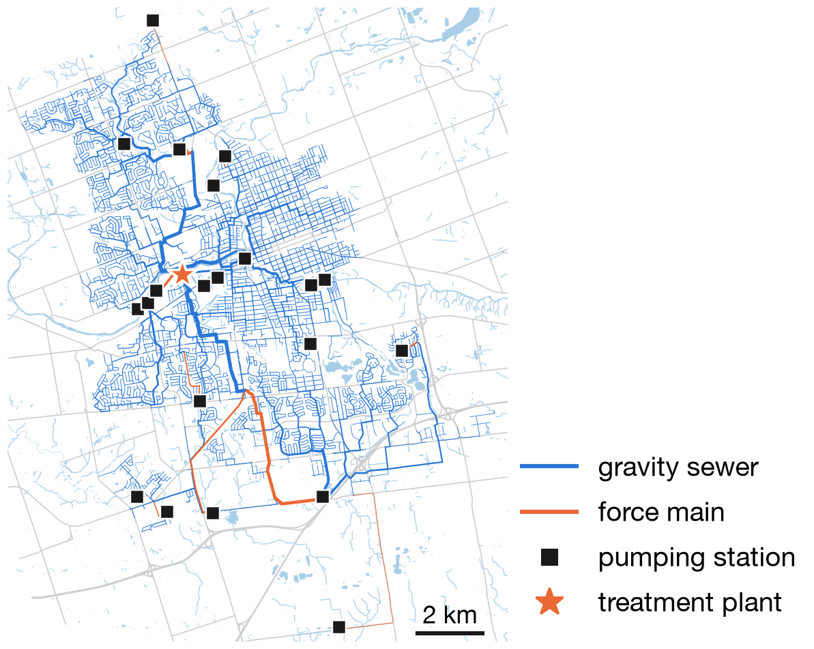</div><div></div>
  <div class="thumb">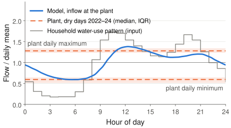</div><div></div>
  <div class="thumb"></div><div></div>
  <div class="thumb"></div><div></div>
  <div class="thumb"></div><div></div>
  <div class="thumb">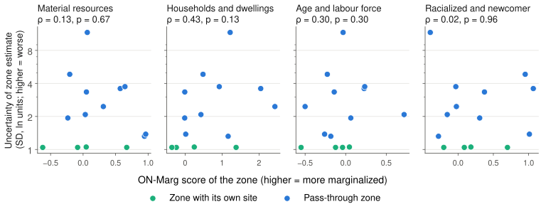</div>
  <!-- row 3: arrows up from the inputs -->
  <div></div><div></div><div class="up">↑</div><div></div><div></div><div></div><div class="up">↑</div><div></div><div></div><div></div><div class="up">↑</div>
  <!-- row 4: inputs under the step they feed -->
  <div></div><div></div><div class="rm-box rm-data">Census population<span>2021 dissemination blocks</span></div><div></div><div></div><div></div>
  <div class="rm-box rm-data">Lab noise<span>four years of composites</span></div><div></div><div></div><div></div>
  <div class="rm-box rm-data">Marginalization<span>ON-Marg 2021</span></div>
</div>
```

[Grey: data. Blue: building the model. Green: the statistical design. Purple: equity.]{.src}

::: {.notes}
Roadmap. Everything runs on open data plus the group's own monitoring record. Each section of the
talk is one or two boxes of this chain, and the small pictures are the figures you'll see in each:
the network (slide 6), dry-day flows (7), who is in a composite (9), what a plan can identify (12),
an adaptive campaign (17), and precision by neighbourhood (21). The data enter where they're used:
census population places people on the pipes, four years of lab composites give the noise, and
ON-Marg gives the marginalization of each neighbourhood.
:::

## A model of every public sewer in the catchment is built from the City's open data

::: {.columns}
::: {.column width="58%"}
{.fig-fill .figctr style="height:440px;width:auto;max-height:440px"}
:::
::: {.column width="42%"}
```{=html}
<div class="stat-stack">
  <div class="stat"><b></b> nodes</div>
  <div class="stat"><b></b> pipes</div>
  <div class="stat"><b></b> pumping stations</div>
  <div class="stat"><b></b> data issues found and resolved or flagged</div>
</div>
```

[`swmmbuilder` turns the City's GIS layers into a SWMM model. Open data need checking: one typo in an invert backed up a whole trunk.]{.takeaway}
:::
:::

[Source: City of London open data (Open Government Licence – London); swmmbuilder, DeGroot Research Group.]{.src .tight}

::: {.notes}
swmmbuilder: selects built sanitary pipes, splits reused node IDs, merges duplicate nodes, extracts
the catchment, fills and flags gaps, allocates population, adds pumps and loading. Every fill and
assumption is in a register (Appendix 2). Pumps are ideal (pass their inflow). Dynamic-wave routing,
three repeating dry days, day 3 kept.
:::

## People are placed on the pipes from census blocks, and the model's dry-day flows match the plant

::: {.columns}
::: {.column width="64%"}
{.fig-fill style="max-height:440px"}
:::
::: {.column width="36%"}
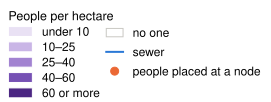{style="width:92%;margin:0"}

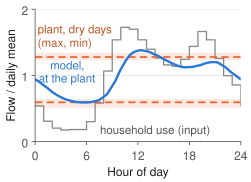{style="width:70%;margin:0"}

[$R_n(t) = \lambda\, f_{z(n)}\, P_n\, g(t)$]{.slide7-eq}
:::
:::

[ people at  nodes. Infiltration and non-residential flow calibrated to the plant's dry-day flow.]{.src .tight}

::: {.notes}
Census dissemination blocks (about a city block each), shaded by people per hectare: the whole
catchment on the left, and a 1.2 km window on the right. Each block's people are shared among the
sanitary pipes within reach, in proportion to their private drain connections; the orange dots are
the people each node ends up with. (On the map a block is drawn when its nearest pipe is in the
catchment, which matches the model's population to within 0.3 %.)

The equation: shedding at node n is the rate per person lambda, times the zone factor f_z, times the
people at the node P_n, times the household water-use pattern g(t), the grey steps in the inset. Residential flow follows an hourly household
pattern. Infiltration and non-residential flow aren't measured, so they're calibrated to the
plant's median dry-day flow and its night minimum. Non-residential flow dilutes but carries no
biomarker. f_z is one everywhere under uniform shedding; it's the unknown the design is about.
:::

## The catchment is cut into  neighbourhoods of – % of the people, each ending where it could be sampled

::: {.columns}
::: {.column width="46%"}
{.fig-fill .figctr style="height:420px;width:auto;max-height:420px"}

[Most uniform partition (Lucertini et al. 1993), by dynamic programming; splits follow their largest pipe for zoning only. Appendix 4.]{.src .tight}
:::
::: {.column width="54%"}
[Each zone's outlet is a candidate site: a pumping station or a maintenance hole without a drop.]{.takeaway}

[ of  are **pass-through** zones (dashed): their outlet also carries other zones.]{.takeaway}

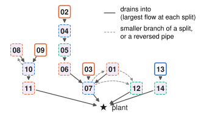{style="width:100%;margin:0.2em 0 0 0"}
:::
:::


::: {.notes}
Zones are cut to make populations as even as the network allows: the most uniform partition,
which makes the largest and the smallest zone as close as possible, found exactly by dynamic
programming (Appendix 4). Only nodes that could be sampled can be cuts. To draw zones, each of the
 flow splits is assigned to the pipe carrying the most flow, so every arriving
sewer's network becomes a tree. The transport model keeps the real splits, so flow down the smaller
pipe still reaches another zone's outlet: those are the dashed arrows. The one from zone 10 to zone
08 is different, a flat pipe that flows against its drawn direction in the model (data issue D33). The three sewers arriving at the plant and one pumping station are cut where they
arrive. Pass-through zones matter later: they can only be estimated by differencing two sites.

The tree on the right shows which zone drains into which, with the plant at the bottom and the four streams that reach it. Solid arrows follow the main path. Dashed arrows are part of a zone's flow that a split sends into another zone's outlet: zone 7 and zone 1 into zone 12's outlet, a little of zone 7 into zone 1's, and part of zone 10 into zone 8's, through a flat pipe that flows against its drawn direction. That is why zones 1, 8, and 12 count as pass-through although nothing drains into them on the main path.
:::

## A plant composite counts every neighbourhood in proportion to its population

::: {.columns}
::: {.column width="64%"}
{.fig-fill}
:::
::: {.column width="36%"}
$$
\bar C_s = \sum_z f_z\, C_{s,z}(k)
$$
$$
W_{s,z} = \frac{f_z C_{s,z}}{\sum_{z'} f_{z'} C_{s,z'}}
$$

[$W_{s,z}$, the **representation fraction**: the share of a composite's virus that comes from zone $z$.]{.takeaway}
:::
:::

[Plant shares within  points of population shares. Decay changes the log composite by – % per unit change in ln k.]{.src .tight}

::: {.notes}
This answers the title question for the plant. Four streams reach the plant: three arriving sewers and the force main of the Berkshire Village pumping station. A sample from one of them counts only the zones it drains, each in proportion to its people; WT1420 and OS2272 share zones 1 and 7 at flow splits. Travel times are hours, so decay and the diurnal
hydraulics barely matter for 24 h composites; connectivity, population, and flow splits do. A
-fold hot spot in one zone raises the plant composite only
– times, less than the noise of one composite.
The transport is a linear operator from every release to every site, computed once (Appendix 5).
:::

## Composites are noisy: a log standard deviation of  at the plant and  upstream

::: {.columns}
::: {.column width="68%"}
{.fig-fill}
:::
::: {.column width="32%"}
$$
y_c = \ln \bar C_c + \varepsilon_c
$$
$$
\varepsilon_c \sim \mathcal{N}(0, \sigma_s^2)
$$

[σ = 0.8 means a single result is often off by a factor of two. Occasional wild values too (Appendix 9).]{.takeaway}

[Noise doesn't change which contrasts a plan identifies, only how many days it takes to tell zones apart. Without it, one day at each of  sites would tell every pair apart.]{.takeaway}
:::
:::

[The group's 24 h composites, Dec 2020 – Aug 2024, after the April 2023 extraction change: plant and the Victoria Hospital sewershed.]{.src .tight}

::: {.notes}
Error is multiplicative (qPCR, concentration steps), so it's normal on the log scale. Split into
qPCR replicate, biological replicate, and day-to-day parts about a running trend. The day-to-day
part dominates. Later, the analysis replaces the normal with a Student-t, because the residuals
have heavier tails than a normal (nu about  at the plant and
 upstream).

Why this matters for what follows. Which contrasts a plan can identify depends only on how the flows
mix the zones (slide 12): noise scales the information but never changes its rank. How confidently
two zones are told apart is measured in noise widths (slide 13), so the noise sets the number of days.
At the precision plan's  site-days every contrast is identified and
every pair would be told apart without noise; with this noise about three quarters are, and telling
all of them apart takes .
:::

## Only differences between neighbourhoods can be learned, so prevalence never needs a value

::: {.columns}
::: {.column width="58%"}
{.fig-fill}
:::
::: {.column width="42%"}
::: {.eq-small}
$$
\underbrace{\ln\lambda\,\mathbf{1}}_{\substack{\text{rate per}\\ \text{person}}} +
\underbrace{\ln\mathbf{f}}_{\substack{\text{zone}\\ \text{factors}}} =
\underbrace{\textcolor{#6b6a66}{m\,\mathbf{1}}}_{\text{level}} +
\underbrace{\textcolor{#eb6834}{\mathbf{H}\boldsymbol{\beta}}}_{\text{differences}}
$$
:::

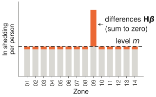{style="width:92%;margin:0"}

[The level absorbs prevalence and $\lambda$. A plan estimates the  **contrasts** $\boldsymbol\beta$.]{.takeaway}
:::
:::

::: {.notes}
Anything that multiplies every zone's shedding multiplies every concentration alike: every site
rises by the same amount on the log scale (left). A hot zone gives a pattern across sites (right). Zone
09's own outlet, WO635, rises most; the sites downstream of it (WT160, the arriving sewer WT2203,
and the plant) rise less, because zone 09 is a smaller share of what they carry, and every other
site doesn't move.
Reading the equation: lambda is the shedding rate per person, common to every zone; f_z is zone z's
shedding factor, a multiplier on lambda that is 1 when shedding is uniform (not a fraction). So the
left side is each zone's log shedding per person, and the right side splits it into a level shared
by all zones and differences between them.

The small picture under the equation is the same idea for the zones' shedding: every zone's log
shedding is a shared level (grey, up to the dashed line m) plus a difference (orange: zone 09 up, the
rest a little down, so the differences sum to zero). Prevalence and shedding per person only move the
level; the 13 contrasts are the differences. H is a 14 x 13 matrix whose columns are orthonormal
and each sum to zero; beta holds 13 numbers. Any such basis gives the same results. So the design needs no shedding or prevalence numbers. H is an orthonormal basis of zero-sum
directions; the decay rate is the other nuisance parameter, with a prior spanning a factor of
 either way.
:::

## Repeat days at the plant add nothing: the plant and its arriving sewers identify at most  of  contrasts

::: {.columns}
::: {.column width="62%"}
{.fig-fill style="max-height:420px"}
:::
::: {.column width="38%"}
[$\mathbf{S}$: the information a plan's composites carry about the  contrasts, once the level and decay are allowed for.]{.takeaway}

[**Rank of $\mathbf{S}$**: how many contrasts can be estimated at all. Below , some zones are mixed in the same proportions at every sampled site, and no number of days separates them.]{.takeaway}

$$
\operatorname{Cov}(\hat{\boldsymbol\beta}) \succeq \mathbf{S}^{-1}
$$

[$\hat{\boldsymbol\beta}$: the estimate of $\boldsymbol\beta$. At full rank $\mathbf{S}$ can be inverted, so every estimated contrast has a finite variance.]{.takeaway}
:::
:::

::: {.notes}
β would be fitted by weighted least squares of the log composites on each site's representation
fractions (Appendix 6); S tells us how precise that fit can be, before any sample is taken.
Repeat days shrink the noise on the same mix but can't unmix it. The plant alone identifies none:
the level absorbs its one direction. Its arriving sewers mix zones in different proportions, but
none isolates a zone. One day at  sites identifies all
. In general: n arriving streams identify at most n − 1 contrasts.
The bound Cov(β̂) ≥ S⁻¹ is the Cramér–Rao bound; for the weighted least-squares fit of the linearized
model with normal errors it is reached. Derivation in Appendix 6. The blue curve here is the greedy plan for precision (most contrasts, then D_s); the
fixed plan on slides 4, 13, and 14 is a different greedy plan, built to tell pairs apart.
:::

## Telling every pair of zones apart takes  site-days at  sites

::: {.columns}
::: {.column width="64%"}
{.fig-fill}
:::
::: {.column width="36%"}
$$
\delta_{ij}^2 = \sum_s \omega_s \Delta_s^2 - \frac{\left(\sum_s \omega_s \Delta_s\right)^2}{\sum_s \omega_s}
$$

[$\Delta_s$: the difference at site $s$ between a hot spot in zone $i$ and one in zone $j$; $\omega_s = n_s/\sigma_s^2$. Told apart if $\delta_{ij} \ge 2$.]{.takeaway}

[**Goal:** tell every pair apart. That is stricter than identifying every contrast.]{.takeaway}

[**Greedy search:** each point on the curve adds the site-day that tells the most new pairs apart.]{.takeaway}
:::
:::

[-fold hot spot.  site-days at  sites separate  % of pairs.]{.src .tight}

::: {.notes}
delta uses normal noise with the composite standard deviations (0.61 at the plant and arriving sewers,
0.83 upstream), no background between zones, and no heavy tails. It is computed from expected results,
before any sample.
A change of goal from slide 12. There, a plan was judged by how many contrasts it identifies and how
precisely (the precision plan, ranked by rank and then D_s). Full rank means every contrast can be
estimated, not that a hot spot stands out from the noise. Here a plan is judged by how many pairs of
zones it tells apart above the noise, which is what locating a hot spot needs. This is the fixed plan
on slide 4.

The level is unknown, so only the pattern across sites counts: the weighted mean of Delta is
removed. Two noise widths apart still confuses the pair about 16 % of the time. The next slide
shows how the plan was built. The extra days go to the outlets of the pass-through
zones.
:::

## The fixed plan grows one site-day at a time, each time adding the day that tells the most pairs apart

[The -site-day plan was found by a greedy search that scores each candidate day by how many pairs it brings to $\delta \ge 2$.]{.takeaway}

```{=html}
<div class="gsteps" id="gsteps" aria-label="The greedy plan for telling pairs apart, one site-day at a time: the pairs told apart and the days at each site">
  <div class="gs-head"><span class="gs-count"></span><button class="gs-replay" type="button">↻ replay</button></div>
  <div class="gs-body">
    <div class="gs-tri"><div class="gs-title">Pairs of zones</div><div class="gs-grid"></div>
      <div class="gs-key"><i class="on"></i>told apart (δ ≥ 2) <i class="new"></i>this step <i></i>not yet</div></div>
    <div class="gs-plan"><div class="gs-title">Days at each site (zone outlet)</div><div class="gs-rows"></div></div>
  </div>
</div>
<script src="figures/greedy_frames.js"></script>
<script>
(function () {
  const D = window.GREEDY_FRAMES, root = document.getElementById("gsteps"), n = D.zones.length;
  const S = D.steps, last = S.length - 1, grid = root.querySelector(".gs-grid");
  const count = root.querySelector(".gs-count");
  // Lower triangle: row i (zones 02..14) against column j < i, with zone labels on the diagonal.
  grid.style.gridTemplateColumns = "repeat(" + n + ", 1fr)";
  const cells = [];
  for (let i = 1; i < n; i++) for (let j = 0; j < n; j++) {
    const d = document.createElement("div");
    if (j < i) { d.className = "c"; cells.push(d); }
    else if (j === i) { d.className = "lab"; d.textContent = D.zones[i]; }
    grid.append(d);
  }
  const bottom = document.createElement("div"); bottom.className = "gs-bottom";
  bottom.style.gridTemplateColumns = grid.style.gridTemplateColumns;
  D.zones.slice(0, n - 1).forEach(z => { const d = document.createElement("div"); d.textContent = z; bottom.append(d); });
  grid.after(bottom);
  const cols = ["P"].concat(D.zones), rows = root.querySelector(".gs-rows");
  const rowEls = cols.map(c => {
    const r = document.createElement("div"); r.className = "gs-row";
    r.innerHTML = '<span class="gs-lab">' + (c === "P" ? "plant" : c) + '</span><span class="gs-dots"></span>';
    rows.append(r); return r;
  });
  function show(k) {
    const st = S[k], prev = k ? S[k - 1].told : null;
    count.innerHTML = "<b>" + st.site_days + " site-day" + (st.site_days > 1 ? "s" : "") + "</b> at " + st.sites +
      " site" + (st.sites > 1 ? "s" : "") + ": <b>" + st.pct + " %</b> of pairs told apart";
    cells.forEach((c, i) => {
      const on = st.told[i] === "1";
      c.className = "c" + (on ? (prev && prev[i] === "0" ? " new" : " on") : "");
    });
    rowEls.forEach((r, i) => {
      const n = st.days[cols[i]] || 0, add = cols[i] === st.added && k > 0;
      r.querySelector(".gs-dots").innerHTML = Array.from({ length: n }, (_, j) =>
        '<i' + (add && j === n - 1 ? ' class="new"' : "") + "></i>").join("");
      r.classList.toggle("used", n > 0);
    });
  }
  let timer = null;
  function play() {
    clearInterval(timer); let k = 0; show(0);
    timer = setInterval(() => { k += 1; show(k); if (k >= last) clearInterval(timer); }, 750);
  }
  show(last);
  root.querySelector(".gs-replay").addEventListener("click", play);
  // Automated captures (decktape for the PDF) keep the finished plan; a live deck plays on arrival.
  if (navigator.webdriver) return;
  (function wait() {
    if (!window.Reveal || !Reveal.isReady()) return setTimeout(wait, 100);
    const here = () => Reveal.getCurrentSlide() && Reveal.getCurrentSlide().contains(root);
    Reveal.on("slidechanged", () => { if (here()) setTimeout(play, 400); else { clearInterval(timer); show(last); } });
    if (here()) setTimeout(play, 400);
  })();
})();
</script>
```

```{=html}
<div class="greedy-steps">
  <div><i>1</i>Start with one day at the plant.</div>
  <div class="arr">→</div>
  <div><i>2</i>Try one more day at each site: how many pairs would reach δ ≥ 2?</div>
  <div class="arr">→</div>
  <div><i>3</i>Keep the best, and repeat until every pair is told apart.</div>
</div>
```

[Only the count of days at each site matters: the dry-day flows repeat and the hot spot is taken as steady.]{.takeaway}

::: {.notes}
How the fixed plan on slides 4 and 13 was built. The score is the number of pairs told apart, not D_s. The animation plays every step (replay button top right). The
triangle is every pair of zones; a square fills once a
5-fold hot spot in one zone of the pair would look different from one in the other by at least two
noise standard deviations (the separation on the previous slide). The greedy search starts from one day
at the plant, tries one more day at every candidate site, keeps the day that separates the most pairs,
and repeats; it never revisits earlier choices. After 4 site-days the plant and three sites separate
18 % of pairs, after 10 site-days 56 %, and after 38 site-days every pair.
Yellow marks what the latest step added: the site-day on the right (a dot per day at that zone's outlet)
and the pairs it told apart on the left. The early days spread over new sites; the late ones are repeat
days at a few outlets (05, 06, and 10) for the last stubborn pairs: from 27 site-days on, many steps
tell no new pair apart, and only 4 more pairs fall in the last 12 steps. The last step, a
fifth day at zone 06's outlet, separates 06 from 07.

Timing: a fixed plan is a count of days at each site. The hydraulics repeat from day to day and the
hot spot is assumed steady over the campaign, so each composite at a site carries the same
information whichever day it's taken: the days could be consecutive, spread out, or in parallel.
That's what "any order" meant on slide 4. The adaptive campaign is different: there the order
matters, because each day's choice uses the results so far.
:::

## A zone is named when its probability of being hot reaches  %

[Separation scores a plan on its expected results; naming decides from one campaign's noisy results.]{.takeaway}

::: {.columns}
::: {.column width="58%"}
::: {.eq-small}
$$
y_c =
\underbrace{\textcolor{#6b6a66}{\mu}}_{\text{level}} +
\underbrace{\textcolor{#c2501c}{Y_{s,h}}}_{\substack{\text{hot-zone}\\ \text{pattern}}} +
\underbrace{\textcolor{#12805a}{\textstyle\sum_z \hat W_{h,s,z}\, u_z}}_{\text{background}} +
\underbrace{e_c}_{\text{noise}}
$$
:::
$$
u_z \sim \mathcal{N}(0, \tau^2), \qquad e_c \sim \text{Student-}t
$$
$$
p_h \propto \pi_h\, p(\mathbf{y}\mid h), \qquad P_z = \sum_{h:\, z \in \mathcal{G}_h} p_h
$$

[The **background** $u_z$: zones differ even with no outbreak, and repeat days don't average it out. $\tau = $ is assumed.]{.takeaway}
:::
::: {.column width="42%"}
```{=html}
<div class="pbars" id="pbars" aria-label="Each zone's probability of being hot, morning by morning, in the example campaign, with the composites analyzed">
  <div class="pb-head"><span class="pb-morning">Morning 23</span><button class="pb-replay" type="button">↻ replay</button></div>
  <div class="pb-plot">
    <div class="pb-y"><span style="bottom:100%">1.0</span><span style="bottom:50%">0.5</span><span style="bottom:0">0.0</span></div>
    <div class="pb-area">
      <div class="pb-grid" style="bottom:50%"></div>
      <div class="pb-stop"><span>95 %: name the zone</span></div>
      <div class="pb-bars pb-row"></div>
    </div>
    <div class="pb-ylabel">P(hot)</div>
  </div>
  <div class="pb-x pb-row"></div>
  <div class="pb-dots"><span class="pb-rowlab">results in</span><div class="pb-row" data-k="results"></div></div>
  <div class="pb-dots"><span class="pb-rowlab">sent to lab</span><div class="pb-row" data-k="sent"></div></div>
  <div class="pb-xlabel">Zone (a dot is a composite at the zone's outlet)</div>
</div>
<script src="figures/posterior_frames.js"></script>
<script>
(function () {
  const D = window.POSTERIOR_FRAMES, root = document.getElementById("pbars");
  const cols = ["P"].concat(D.zones), last = D.mornings.length - 1;
  const label = root.querySelector(".pb-morning");
  root.querySelector(".pb-stop").style.bottom = (100 * D.stop) + "%";
  const cells = row => cols.map(c => { const d = document.createElement("div"); d.className = "pb-col" + (c === "P" ? " plant" : ""); row.append(d); return d; });
  const barCells = cells(root.querySelector(".pb-bars"));
  cells(root.querySelector(".pb-x")).forEach((d, i) => d.textContent = cols[i] === "P" ? "plant" : cols[i]);
  const dotRows = [...root.querySelectorAll(".pb-dots .pb-row")].map(r => ({ k: r.dataset.k, cells: cells(r) }));
  const els = barCells.slice(1).map((c, i) => {
    const b = document.createElement("div"); b.className = "pb-bar" + (D.zones[i] === D.hot ? " hot" : "");
    const v = document.createElement("span"); v.className = "pb-val";
    c.append(v, b); return { b, v };
  });
  function show(k) {
    const p = D.p[k], top = p.indexOf(Math.max(...p));
    label.textContent = "Morning " + D.mornings[k] + (p[top] >= D.stop ? ": zone " + D.zones[top] + " named" : "");
    els.forEach((e, i) => {
      e.b.style.height = (100 * p[i]) + "%";
      e.v.style.bottom = (100 * p[i]) + "%";
      e.v.textContent = i === top && p[i] > 1.5 / p.length ? p[i].toFixed(2) : "";
    });
    dotRows.forEach(r => r.cells.forEach((c, i) => {
      const n = D[r.k][k].filter(x => x === cols[i]).length;
      c.innerHTML = '<i class="pb-dot"></i>'.repeat(n);
    }));
  }
  let timer = null;
  function play() {
    clearInterval(timer); let k = 0; show(0);
    timer = setInterval(() => { k += 1; show(k); if (k >= last) clearInterval(timer); }, 700);
  }
  show(last);
  root.querySelector(".pb-replay").addEventListener("click", play);
  // Automated captures (decktape for the PDF) keep the last morning; a live deck plays on arrival.
  if (navigator.webdriver) return;
  (function wait() {
    if (!window.Reveal || !Reveal.isReady()) return setTimeout(wait, 100);
    const here = () => Reveal.getCurrentSlide() && Reveal.getCurrentSlide().contains(root);
    Reveal.on("slidechanged", () => { if (here()) setTimeout(play, 400); else { clearInterval(timer); show(last); } });
    if (here()) setTimeout(play, 400);
  })();
})();
</script>
```
:::
:::

[Bars: one simulated adaptive campaign, a -fold hot spot in , the plant and 2 held upstream composites analyzed each morning, results back  days later.]{.src .tight}

::: {.notes}
The step from the last two slides. Pair separation is computed before any sample is taken, from the
expected results, with normal noise and no background: it says whether two zones would look different
on average. A campaign has one set of noisy results, so it has to answer a different question: which
zone is hot, and how sure are we? That needs a probability for every zone at once, against all 13
rivals, from the results actually in hand, and a rule for when to stop. Separating every pair is
necessary for that but not enough, as the next slide shows.

In a campaign the analysis doesn't fit all 13 contrasts. It compares one hypothesis per candidate hot
zone, each fitted by iteratively reweighted least squares, and turns the fits into probabilities
(Appendix 8).
Hypothesis h: which zone is hot, and how strongly; Y_{s,h} is the pattern it predicts. Bayes'
rule over hypotheses: each names a hot zone and a factor from a set (strength isn't known).
mu and u are integrated out (Laplace), so the evidence depends on the hypothesis and on tau only.
A site that reads high can be explained by a zone that always runs a little high. Student-t lets one
wild composite be an outlier rather than a hot spot.

How the equation connects to what came before. mu is the level from the contrasts slide: it absorbs
the rate per person and the prevalence. Y_{s,h} = ln sum_z W_{s,z} f_{h,z} is the representation
fractions slide with hypothesis h's shedding (kappa in the hot zone, one elsewhere): what that site
would read. The background u_z is the differences H beta from the contrasts slide, now treated as
random with spread tau rather than estimated. e_c is the noise slide's epsilon, with heavier tails.
And the difference Y_{s,h} minus Y_{s,h'} between two hypotheses is the Delta_s in the pair separation:
naming compares exactly the patterns the fixed plan was built to tell apart.

The bars play through every morning of the example adaptive campaign coming up: simulated, one
5-fold hot spot in zone 09, the plant and two held upstream composites analyzed each morning, results
back  days later. Of  such campaigns,  named zone 09; this one has the median site-days
(, named on morning ). It is not the fixed plan. Replay button top right.
The dots under the bars are the composites: filled, the results that arrive that morning and update
the bars; hollow, the composites the lab starts that morning, chosen from those bars. Each upstream
site is a zone's outlet, so a dot sits under that zone; the plant has its own column and is analyzed
every day. Two dots in one column are two held days from the same site.
Zone 01 leads early (about 0.3), then 07 for a few mornings; from morning 13 zone 09 leads, climbing
with two setbacks as results scatter, and is named on the last morning. Details: Appendix 8.
:::

## A fixed plan that separates every pair names the hot zone at  % in only  % of runs

{.fig-fill}

[Simplest case: the naming model without the background and heavy tails. The plant alone:  %, chance.]{.takeaway}

::: {.notes}
Pair separation is a property of the plan; naming is a property of a campaign's results.
Separation compares expected results: a gap of  standard deviations between
two zones. One campaign is one noisy draw, and at that gap the pair is still confused about
 % of the time. With 13 rivals, the small chance that each overtakes the
true zone adds up.

Two analyses are on the plot. The simplest case (blue, green, orange) is the naming model of the
previous slide with the background u_z set to zero, normal rather than Student-t noise, and the
hot-spot strength known; the best guess is then simply the most likely zone. The realistic case
(purple) is that model in full, with simulated data that have heavy tails and a background.
Read the drop at the fixed plan's  site-days in two steps. Step 1, the
noise: with the same score (is the best guess right?) it falls from  % to
 %, through wild values and persistent differences between zones that
the analysis has to allow for. Step 2, the score: being named at  % asks for
more than being the best guess, since the true zone must beat every rival by a clear margin, which
happens in only  % of runs. Even 14 days at every site reach only
 %. The plan
was designed to separate pairs, not to reach confidence. Report the share of simulated campaigns that name the right
zone, not pair separation.
:::

## An adaptive campaign follows the results: it starts at the arriving sewers and homes in on the high ones

{.fig-fill}

[Every sampler collects daily and holds its composites. Each morning the lab analyzes the plant and 2 chosen ones; results arrive  days later. Named on day  after  site-days.]{.takeaway}

::: {.notes}
Each morning, sites are chosen to separate the hypotheses still in contention, weighted by their
current probabilities (score U(s), Appendix 8). The probability of the hot zone falls back twice as
results scatter: the analysis allows for outliers and for zones that run high without a hot spot.
This campaign is the one with site-days closest to the median of those that named zone 9.
:::

## Adaptive campaigns name the hot zone in  % of runs, and  % of names are right

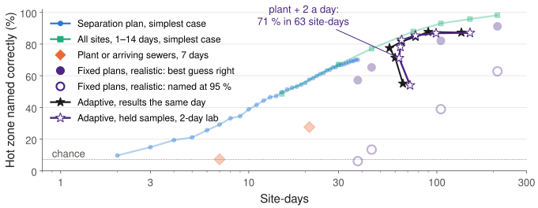{.fig-fill}

[Median  site-days over  days. With no hot spot, a zone is named in  % of runs.]{.takeaway}

::: {.notes}
The rest end without a name rather than with a wrong one. An analysis that ignores the tails and
background names a zone in  % of runs with no hot spot. The naive analysis (normal errors, no
background, known strength) names a zone in nearly every run, including most with no hot spot: the
statistics must carry the features of the data. More composites a day shorten the campaign; beyond
about four they add little else (Appendix 10).
:::

## Only a strong outbreak is found:  % at 2-fold,  % at 3-fold,  % at 10-fold

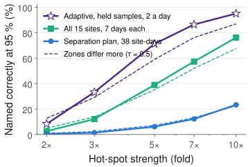{.fig-fill}

[2–3-fold is a typical worse-off neighbourhood; 5–10-fold an early local outbreak.]{.takeaway}

::: {.notes}
Weak hot spots mostly end with "no zone stands out", not a wrong name. Evidence on kappa (Appendix 7): case rates in the worst parts of Toronto and Louisville were about
1.5–3.5 times the city's; N1/PMMoV in sewersheds of 10–20 thousand people differed 5–9-fold. With the
plant and two upstream sites a day for up to  days, this is a tool for a
strong, early local outbreak.
:::

## Names can be trusted only if ordinary differences between neighbourhoods aren't underestimated

{.fig-fill}

[If zones differ by τ =  but the analysis assumes , right names fall from  % to  % (5-fold), with no warning.]{.takeaway}

::: {.notes}
tau is the one assumed input. Too small, and "no answer" becomes a confident wrong answer.
Assuming a larger tau protects names only in part and costs many names when tau is small. The fix
is to measure it: a few weeks of composites at the candidate sites in ordinary times would bound
the background plus flow-model error. Flow errors (site bias) matter less (Appendix 10).
:::

## Precision follows a zone's place in the network, not its marginalization

{.fig-fill}

[Precision plan,  site-days. Pass-through zones (blue) are least precise on every dimension.]{.takeaway}

::: {.notes}
Each dot is a zone; the y axis is how uncertain its estimate is (standard deviation of its log
shedding factor) in the first plan that identifies every contrast, the precision plan at
 site-days. Higher is worse. The  zones with their
own site sit at about ; the  pass-through zones, estimated as
the difference of two noisy composites, range from  to .
ON-Marg scores each dissemination area on four dimensions; material resources covers low income,
unemployment, lone-parent families, education, and housing in need of repair. A zone's score is the
population-weighted mean of its DAs. Spearman's rho with each: material resources 
(p = ), households and dwellings  (p = ), age and
labour force  (p = ), racialized and newcomer 
(p = ). With 14 zones none is clear; households is the largest and worth naming if asked. The pass-through zones are somewhat more marginalized on
average, but the uncertainty doesn't gather among the more marginalized residents. Nothing in a
network guarantees that, so the check belongs in any design.
:::

## Designing for the worst-estimated zone brings every zone within a factor of  in  site-days, not 

{.fig-fill}

[*Fair* here means every zone estimated equally well; the best-estimated zones pay for it.]{.takeaway}

::: {.notes}
The minimax design moves days to the trunk sites. D_s maximizes overall precision, so added days go to zones already well estimated; its worst zone
stays several times less precise than its best. Minimax adds the site-day that most reduces the
largest zone SD. A zoning cut by marginalization or a wider pool of sites doesn't remove the
pass-through disadvantage (Appendix 12).
:::

## Conclusions

- A plant composite counts every neighbourhood by its population, so plant samples can't locate a rise, however many days are sampled.
- A network model says which upstream samples can. Adaptive sampling with held composites names a strong outbreak in  % of campaigns; a 2–3-fold one rarely.
- Names can be trusted only if the analysis allows for wild values and for ordinary differences between neighbourhoods, and those differences should be measured.
- The zones between sites on a trunk sewer are estimated worst; designing for the worst zone fixes most of it.

::: {.notes}
What a program needs for this: the network topology, the population upstream of each candidate
site, and its own lab's noise, which a utility and a lab already hold. Limits: dry weather, shedding
by residents only.
:::

## Questions?

::: {.columns}
::: {.column width="60%"}
Christopher T. DeGroot · christopher.degroot@uwo.ca

Co-author: Anthony P. R. Sherratt

[Funding: NSERC (RGPIN-2024-05703) and the Ontario Ministry of the Environment, Conservation and Parks. Thanks to the City of London for plant access, sampling, and help with the GIS data.]{.takeaway}
:::
::: {.column width="40%"}
::: {.callout-note}
QR code to the deck, paper, and code: to add once the repository names are fixed.
:::
:::
:::

## Appendix 1: Literature {.divider}

[Prior work on choosing sites or locating sources in sewer and water networks.]{.divider-sub}

## Each prior study has one or two of the features a plan for locating shedding needs {.smaller}

| Study | Objective | Noise | Transport | Distrib. | Days | Identif. | Adaptive | Even |
|---|---|:-:|:-:|:-:|:-:|:-:|:-:|:-:|
| Calle 2021 | Coverage; binary search | – | – | ◐ | – | – | ● | ◐ |
| Kim 2022 | Equal monitored areas | – | – | – | – | – | ◐ | ◐ |
| Larson 2020 | Binary search | – | – | ◐ | – | – | ● | – |
| Nourinejad 2021 | Sensors for binary search | – | – | ◐ | – | – | ● | ◐ |
| Gkatzioura 2023 | Detection | – | ● | – | – | – | – | – |
| Banik 2017 | Detection; entropy | – | ● | – | – | – | – | – |
| Banik 2015 | Joint entropy | – | ● | – | – | – | – | – |
| Yao 2024 | Entropy of detects | – | ◐ | – | – | – | – | – |
| Yao 2025 | Entropy; Bayesian elimination | ◐ | ◐ | – | – | – | ● | – |
| Salem 2024 | Inverse-model accuracy | – | ● | ◐ | – | – | – | – |
| Crowley 2025 | Mutual information | ● | ◐ | – | – | – | – | – |
| Yang 2024 | Bayesian inversion | ● | ● | ◐ | – | ◐ | ◐ | – |
| Wagner 2015 | Adjoint inversion | ● | ● | – | – | – | – | – |
| Xie 2015 | D-optimal decay | ◐ | ● | – | – | ● | – | – |
| Khorshidi 2018 | Value of information | – | ● | ◐ | – | – | – | – |
| Torres 2026 | Disaggregating plant data | ● | – | ● | – | – | – | – |
| Impalli 2025 | Cost, frequency | ◐ | – | – | ● | – | – | – |
| **This study** | Fisher information; naming | ● | ● | ● | ● | ● | ● | ● |

: {.lit-table .lit-full}

## Appendix 2: Data {.divider}

[Data sources and the register of data issues.]{.divider-sub}

## The open data needed  corrections:  resolved,  provisional,  open

::: {.callout-note}
FIGURE NEEDED: two or three before/after examples from the register (e.g. the Ridout Street pipes
listed as proposed, without which about 590 maintenance holes miss the plant; the Dingman Creek
force main). Source: SI Table S-dataissues.
:::

[Data: City of London sewer network, 2021 census dissemination blocks and areas, zoning, NRCan HRDEM lidar, plant flow summaries, ECCC rainfall, the group's monitoring composites, ON-Marg 2021.]{.src}

## Appendix 3: Hydraulic model {.divider}

[Network build, loading, and calibration.]{.divider-sub}

## The model reproduces the plant's diurnal swing on dry days

{.fig-fill}

::: {.notes}
TO ADD: calibration iterations (SI Section S3) and the swmmbuilder build steps.
:::

## Appendix 4: Zoning {.divider}

[How the catchment is cut into zones.]{.divider-sub}

## Zones are cut so the largest and smallest are as close in population as the network allows {.smaller}

::: {.columns}
::: {.column width="48%"}
Choose cut nodes $c_1, \dots, c_{N}$ to

$$
\min_{\text{cuts}} \; \Big(\max_z P_z - \min_z P_z\Big)
$$

then, among the equally good cuts,

$$
\min \sum_z \big(s_z - 1/N\big)^2
$$

[$P_z$, $s_z$: zone $z$'s people and share; $N = $ zones. The most uniform partition of Lucertini et al. (1993).]{.takeaway}
:::
::: {.column width="4%"}
:::
::: {.column width="48%"}
1. **A tree.** At each of the  flow splits, keep the pipe with the largest flow.
2. **Eligible cuts.** Pumping stations, and maintenance holes without a drop (no sewer arriving 0.6 m or more above the outlet).
3. **Dynamic program.** From the upstream ends down, tabulate (cuts above, people flowing on) with every closed zone in $[L, U]$; search $L$ for the least $U - L$. Exact, up to rounding.
4. **Real flows kept.** Transport sends flow down every branch, so zones can share flow.
:::
:::

[Paper SI, zoning. The roots (the arriving sewers and one pumping station) are always cut.]{.src .tight}

::: {.notes}
The dynamic program keeps, at each node, a table of pairs (number of cuts above the node, population
still flowing on below it) that some choice of cuts in its subtree can give with every closed zone
between L and U. Branch tables combine where pipes join; the node is then cut (closing a zone) or
not. The least feasible U never decreases as L grows, so the search steps through the values of L
where it changes. A second pass breaks ties by the sum of squared share deviations. Largest-flow
assignment is only for drawing zones; the representation fractions use the real splits.
:::

## Appendix 5: Transport {.divider}

[The operator from every release to every site.]{.divider-sub}

## Advection, decay, and mixing are linear in the mass released, so one operator serves every scenario

$$
C_s(t) = \sum_n \int G_{s,n}(t, t')\, R_n(t')\, e^{-k\, t_{\mathrm{tr}}}\, \mathrm{d}t'
$$

[Parcels are marched along the time-varying flows, split by flow at junctions, and binned at each site. Computed once from the hydraulics.]{.takeaway}

::: {.callout-note}
TO CHECK: the operator's notation against SI Section S4 before presenting.
:::

## Appendix 6: Information {.divider}

[Fisher information, the Schur complement, and the greedy search.]{.divider-sub}

## Every composite at a site adds the same row of sensitivities, weighted by its noise

Linearized log composites; $\hat{\boldsymbol\beta}$ is their weighted least-squares fit:

$$
y_c \approx m + \mathbf{w}_s\mathbf{H}\boldsymbol{\beta} + \frac{\partial\ln\bar C_s}{\partial\ln k}\,\ln k + \varepsilon_c
$$

$$
\mathbf{j}_s = \left[\, \mathbf{w}_s\mathbf{H},\; 1,\; \partial\ln\bar C/\partial\ln k \,\right]
\qquad
\mathbf{F} = \sum_s \frac{n_s}{\sigma_s^2}\, \mathbf{j}_s^\top \mathbf{j}_s + \mathbf{F}_{\mathrm{prior}}
$$

$$
\mathbf{S} = \mathbf{F}_{\beta\beta} - \mathbf{F}_{\beta n}\mathbf{F}_{nn}^{-1}\mathbf{F}_{n\beta},
\qquad
\operatorname{Cov}(\hat{\boldsymbol\beta}) \succeq \mathbf{S}^{-1},
\qquad
D_s = \ln\det\mathbf{S}
$$

[Rank of $\mathbf{S}$ depends on which sites are sampled, not on how often or how noisily. Zone SD: $\sqrt{[\mathbf{H}\mathbf{S}^{-1}\mathbf{H}^\top]_{zz}}$.]{.takeaway}

::: {.notes}
The subtracted term is the information spent telling contrasts from the level and decay. One
contrast, one nuisance: S = a − b²/c, zero when the two change the composites the same way.
:::

## Appendix 7: Hot-spot strength {.divider}

## A 2–3-fold excess is typical of a worse-off neighbourhood; 5–10-fold of an early local outbreak

- Case rates in the most affected parts of Toronto and of Louisville sewersheds: about 1.5–3.5 times the city or county, over weeks to months.
- N1/PMMoV in sewersheds of 10,000–20,000 people in one city: 5–9-fold apart.
- Much larger ratios only at sites of a few hundred people.
- The design uses κ = ; results are given for κ from 2 to 10.

## Appendix 8: Posterior and site choice {.divider}

## Each morning's sites separate the hypotheses still in contention

$$
U(s) = \sum_{h,h'} p_h\, p_{h'} \left[1 - \exp\!\left(-\frac{\delta_{hh'}(s)^2}{8}\right)\right]
$$

$$
p(\mathbf{y}\mid h) = \int p(\mathbf{y}\mid h, \mu, \mathbf{u})\, p(\mathbf{u})\, \mathrm{d}\mu\, \mathrm{d}\mathbf{u}
\quad\text{(Laplace)}
$$

[The exponential is the Bhattacharyya overlap of two normals $\delta$ apart. The background is added to each site's variance so repeat days don't average it out.]{.takeaway}

## Appendix 9: Noise {.divider}

## The daily errors have heavier tails than a normal

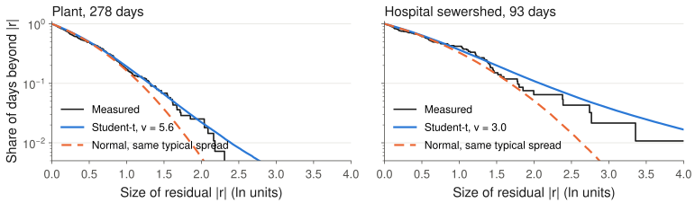{.fig-fill}

## Appendix 10: Robustness and campaign settings {.divider}

## The effort depends strongly on the noise of an upstream composite

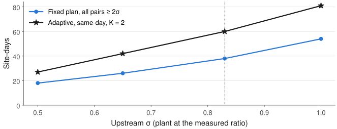{.fig-fill}

## More composites a day shorten a campaign

{.fig-fill}

[With two hot zones, the campaign names one in  % of runs and stops, with no sign of the second.]{.takeaway}

## Appendix 11: Laboratory limits {.divider}

## The lab's limits cost little at Greenway's concentrations

::: {.callout-note}
FIGURE NEEDED: share named against plant concentration with sLOD and sLOQ (paper fig_si_limits).
:::

## Appendix 12: Equity alternatives {.divider}

## Neither a zoning by marginalization nor a wider pool of sites removes the pass-through disadvantage

::: {.callout-note}
FIGURES NEEDED: the ON-Marg zoning map and the wider candidate pool map (paper fig_zones_onmarg,
fig_candidates).
:::

## Appendix 13: Reproducibility {.divider}

## Every number and figure here is drawn from the paper's result files

- Paper repository: analysis scripts, network model, pinned environment (link at release).
- This deck: `scripts/sync_from_paper.py` copies the result files; `scripts/talk_figures.py` draws every figure from them.
- Numbers on the slides are the paper's own generated values.
