## A treatment-plant sample pools many people and reports one number, making it impossible to locate a rise

[A 24 h composite mixes the flow of everyone upstream, so a rise in one neighbourhood is diluted on its way to the plant. It tells public health *how much* is being shed; acting locally also needs *where*.]{.takeaway}

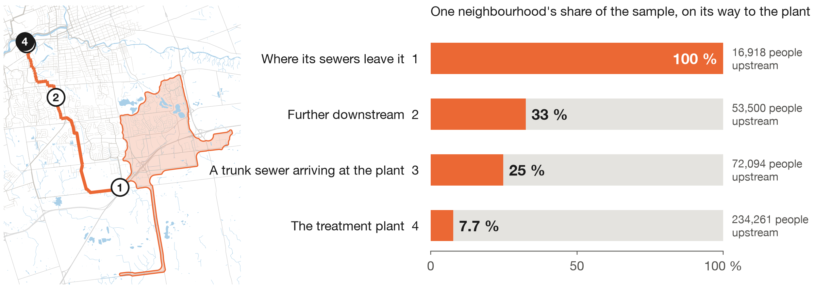{.fig-fill style="max-height:400px"}

[Greenway plant, London, Ontario: about 60 % of the city's wastewater. Shares from the sewer model built later in the talk.]{.src .tight}

::: {.notes}
- The question we seek to answer in this talk is whether we can determine where an increase in signal comes from, given a set of composite samples? 
- A 24 h plant composite is a mixed sample of all individuals in the catchment, so it is cheap per person served. That same pooling is why it can't say which neighbourhood a rise comes from.
- In this example, we follow one neighbourhood of about 17,000 people (it becomes zone 09 later in the talk).
- Where the sewers leave the zone, every bit of a composite taken there represents the zone. By the time it reaches the plant it is 7.7 %, with the share roughly following the people upstream.
- A 5-fold rise there would read 5-fold where its sewers leave, but about 1.3-fold at the plant, inside the plant's day-to-day noise. This makes it hard to detect local rises. 
:::

## Cities already sample upstream, but no method yet chooses the sites and days to locate a rise

::: {.columns}
::: {.column width="47%"}
[Upstream programs today]{.panel-head}

<div class="programs">
<div class="prog"><b>17</b><div><strong>Louisville</strong><span>Residential sewers serving 5,000+ people. Said which sewers, not how many.</span></div></div>
<div class="prog"><b>11</b><div><strong>Boston</strong><span>Per-site alert scales flagged two more vulnerable neighbourhoods a month later than one shared scale.</span></div></div>
<div class="prog"><b>120 → 18</b><div><strong>Hong Kong</strong><span>Cut to keep the territory-wide trend.</span></div></div>
</div>

[Also Lincoln, Toronto, Reno–Sparks, Atlanta, and Seattle, with 5 to several dozen sites each.]{.takeaway}
:::
::: {.column width="5%"}
:::
::: {.column width="48%"}
[What a plan to locate a rise must handle]{.panel-head}

<!-- counts from the Appendix 1 table: studies with ● (full) + ◐ (in part), of 17 -->
<div class="needs">
<div class="need"><i>1</i><div>A composite is noisy<br><span class="dots"><b></b><b></b><b></b><b></b><u></u><u></u><u></u><s></s><s></s><s></s><s></s><s></s><s></s><s></s><s></s><s></s><s></s></span><em>4 + 3</em></div></div>
<div class="need"><i>2</i><div>The virus travels and mixes through the pipes<br><span class="dots"><b></b><b></b><b></b><b></b><b></b><b></b><b></b><b></b><u></u><u></u><u></u><s></s><s></s><s></s><s></s><s></s><s></s></span><em>8 + 3</em></div></div>
<div class="need"><i>3</i><div>Any neighbourhood could be the source<br><span class="dots"><b></b><u></u><u></u><u></u><u></u><u></u><u></u><s></s><s></s><s></s><s></s><s></s><s></s><s></s><s></s><s></s><s></s></span><em>1 + 6</em></div></div>
<div class="need"><i>4</i><div>Effort can go to repeat days, not only new sites<br><span class="dots"><b></b><s></s><s></s><s></s><s></s><s></s><s></s><s></s><s></s><s></s><s></s><s></s><s></s><s></s><s></s><s></s><s></s></span><em>1 + 0</em></div></div>
<div class="need"><i>5</i><div>Later days can follow earlier results<br><span class="dots"><b></b><b></b><b></b><b></b><u></u><u></u><s></s><s></s><s></s><s></s><s></s><s></s><s></s><s></s><s></s><s></s><s></s></span><em>4 + 2</em></div></div>
</div>

[One dot per prior study (17, Appendix 1): filled if it handles the need, half if in part.]{.takeaway}
:::
:::

[Upstream programs: Yeager 2021 (Louisville), Cowger 2025 (Boston), Lo 2025 (Hong Kong). Prior methods, study by study: Appendix 1.]{.src .tight}

::: {.notes}
- Cities are sampling upstream to gain spatial information.
- Louisville (17 sites, including its five plants) wrote the most detailed protocol: residential sewers serving at least 5,000 people, splitting any serving more than 100,000 at a junction upstream, and extra sites where clinical testing was thin. It said which sewers to sample, but not how many.
- Boston (11 sites) added upstream sites because its regional plant serves 43 cities and towns, so the plant can't separate Boston's neighbourhoods. Boston then compared two ways of setting alert levels
on the same data: each site against its own history, or every site on one shared city-wide scale. With the per-site scales, two Boston neighbourhoods, Roxbury and Dorchester, reached the top alert
level 28 and 31 days later than on the shared scale. Both have higher social vulnerability than the rest of the city. So how sites are compared matters, not only where they are. Equity comes back at
the end of the talk.
- Hong Kong cut 120 upstream sites to 18 after the pandemic, keeping the sites that preserved the territory-wide index. That criterion doesn't protect the ability to locate a rise.
- Other cities with upstream programs: Lincoln, Toronto, Reno–Sparks, Atlanta, and Seattle, with five to several dozen sites each, chosen by rules of thumb such as one per postal area or just upstream of large junctions.
- What a method needs to answer is "which neighbourhood?". 
- Each dot strip is the 17 studies of Appendix 1. Not all of the studies are for viruses, some are to find a point source of a release. 
- Travel through the network is well studied (8 fully).
- A few studies consider noise in the sample measurements and plans where later days are chosen based on results to date (4 each). 
- Ability for shedding to be anywhere and plans that consider repeat samples at the same site to gain confidence in a measurement are hardly considered (1 each). 
- No prior study handles more than two of the five fully (Yang 2024 and Wagner 2015 come closest, with noise and transport); this study handles all five. 
:::

## Locating a rise is a choice of sites and days, fixed in advance or adapted to the results

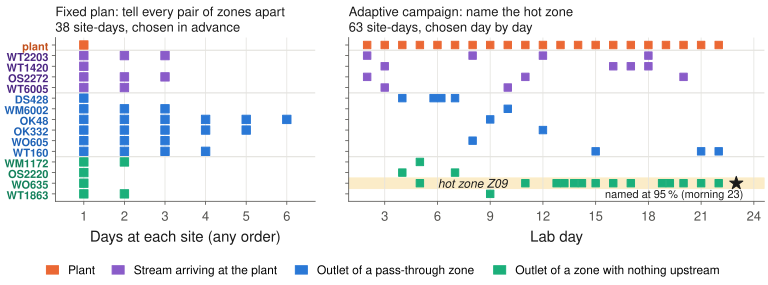{.fig-fill}

[One filled square = one **site-day**: a 24 h composite collected at one site and analyzed. Site-days are the cost.]{.takeaway}

::: {.notes}
- We consider two main ways to spend site-days (defined as one day measuring at a site; two days at the same site is two site-days). A fixed plan decides everything in advance. An adaptive campaign decides each day from the results so far. 
- Both grids are real plans we will look at later. Sites are grouped into the plant, sewers arriving at the plant, and sites further upstream.
- The left is the "separation plan", a fixed plan that it is designed before any data, so it's the same plan wherever the rise is. Its goal is that a rise in any neighbourhood looks different from a rise in any other. 
- It takes site-days at  sites, and the days at a site
can be taken in any order. We come back to the details later. 
- The right is one simulated adaptive campaign, with a -fold rise in one neighbourhood (the shaded row is its sample site). The plant is sampled every day by design, plus two sites chosen from the results so far; samplers hold their composites and results come back  days later. 
- The adaptive plan starts at the arriving sewers, follows the high ones
upstream, and locates the rise on day  (the star), after
 site-days. 
- The adaptive plan spends more site-days than the fixed plan, but it ends with an answer, while in this case the fixed plan cannot confidently identify the hot zone, even though the zones are "separated", but not within the noise of the samples.
- Our questions are:
(i) what can plant samples tell, with and without the sewers arriving at
the plant; 
(ii) how many upstream site-days does a fixed plan need, and how much does adaptive
sampling save; 
(iii) how much do the answers depend on noise and on assumed differences between neighbourhoods; 
(iv) is precision even across neighbourhoods of different marginalization?
:::

## The method chains open data, a sewer model, the virus's travel, and a statistical design

```{=html}
<div class="rmg">
  <!-- row 1: the chain -->
  <div class="rm-box rm-data">City open data<span>pipes, maintenance holes, stations</span></div><div class="arr">→</div>
  <div class="rm-box rm-model">Sewer model<span>SWMM, dry weather, calibrated to the plant</span></div><div class="arr">→</div>
  <div class="rm-box rm-model">Virus transport<span>who is in each composite</span></div><div class="arr">→</div>
  <div class="rm-box rm-stat">What a plan can tell<span>identifiability, separation</span></div><div class="arr">→</div>
  <div class="rm-box rm-stat">Naming the hot zone<span>fixed and adaptive plans</span></div><div class="arr">→</div>
  <div class="rm-box rm-eq">Is precision even?<span>across neighbourhoods</span></div>
  <!-- row 2: thumbnails -->
  <div class="thumb"></div><div></div>
  <div class="thumb"></div><div></div>
  <div class="thumb">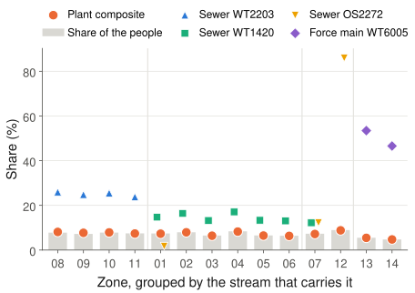</div><div></div>
  <div class="thumb">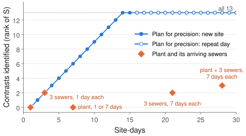</div><div></div>
  <div class="thumb">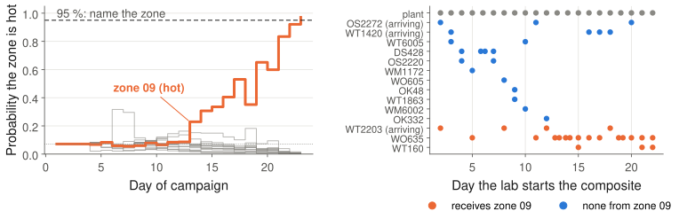</div><div></div>
  <div class="thumb"></div>
  <!-- row 3: arrows up from the inputs -->
  <div></div><div></div><div class="up">↑</div><div></div><div></div><div></div><div class="up">↑</div><div></div><div></div><div></div><div class="up">↑</div>
  <!-- row 4: inputs under the step they feed -->
  <div></div><div></div><div class="rm-box rm-data">Census population<span>2021 dissemination blocks</span></div><div></div><div></div><div></div>
  <div class="rm-box rm-data">Lab noise<span>four years of composites</span></div><div></div><div></div><div></div>
  <div class="rm-box rm-data">Marginalization<span>ON-Marg 2021</span></div>
</div>
```

[Grey: data. Blue: building the model. Green: the statistical design. Purple: equity.]{.src}

::: {.notes}
- This slide gives an overall roadmap for how the study is carried out. Everything runs on open data.
- We start with City of London open data for the sewer network and zoning types (residential, commercial, industrial, etc.), complemented with LiDAR ground level measurements to fill in missing sewer rim elevations.
- The sewer model is built from these data with our own open source code, using census data to assign populations to sewer nodes to define the flows. The dry weather flow is calibrated to 3.5 years of plant data to find the infiltration and non-residential flows.
- Using these flows, we calculate the transport of a virus through the system as a passive scalar. This allows us to calculate what a composite sampler would measure at any point in the system. 
- Using our own lab data, we estimate the noise in plant and upstream samples, which allows us to determine what information samples give about local shedding levels. We look at both identifiability and ability to separate pre-defined zones at a level above the noise. 
- Then we simulate adaptive sampling plans to try to locate a hot zone, which is harder than just separating two zones. Separating zones is one comparison between two named suspects; naming the hot spot means ruling out every other zone at once, with its strength and the background unknown, so the hardest pair decides whether the name is right.
- Finally we use ON-Marg data, which gives the marginalization of each neighbourhood, to assess if sampling plans are equitable.
:::

## A model of every public sewer in the catchment is built from the City's open data

::: {.columns}
::: {.column width="58%"}
{.fig-fill .figctr style="height:440px;width:auto;max-height:440px"}
:::
::: {.column width="42%"}
```{=html}
<div class="stat-stack">
  <div class="stat"><b></b> nodes</div>
  <div class="stat"><b></b> pipes</div>
  <div class="stat"><b></b> pumping stations</div>
  <div class="stat"><b></b> data issues found and resolved or flagged</div>
</div>
```

[`swmmbuilder` turns the City's GIS layers into a SWMM model. Open data need checking: one typo in an invert backed up a whole trunk.]{.takeaway}
:::
:::

[Source: City of London open data (Open Government Licence – London); swmmbuilder, DeGroot Research Group.]{.src .tight}

::: {.notes}
- We built a complete hydraulic model of the Greenway catchment in London, ON which treats about 60% of the city's wastewater. 
- swmmbuilder reads the open data, selects built sanitary pipes, splits reused node IDs, merges duplicate nodes, extracts the catchment, fills and flags gaps, allocates population, and adds pumps and loading. It takes 12 seconds on my laptop to go from the open data files to a ready-to-run SWMM model. 
- Every fill and assumption is in a register (Appendix 2). 
- Pumps are ideal (pass their inflow), which is reasonable for dry weather flow. 
- Dynamic-wave routing in SWMM, three repeating dry days, day 3 kept.
:::

## People are placed on the pipes from census blocks, and the model's dry-day flows match the plant

::: {.columns}
::: {.column width="64%"}
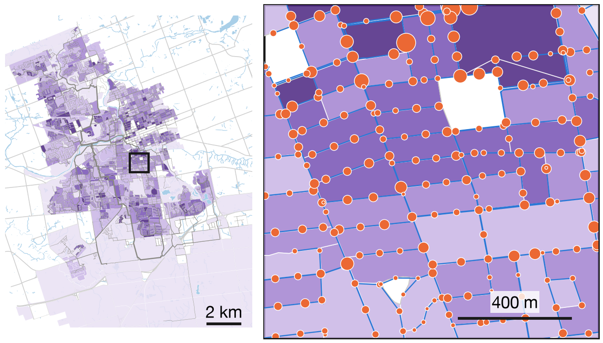{.fig-fill style="max-height:440px"}
:::
::: {.column width="36%"}
{style="width:92%;margin:0"}

{style="width:70%;margin:0"}

:::: {.eq-small .slide7-eq}
$$
\underbrace{R_n(t)}_{\substack{\text{shed at}\\ \text{node } n}} =
\underbrace{\lambda}_{\substack{\text{rate per}\\ \text{person}}}\,
\underbrace{f_{z(n)}}_{\substack{\text{zone}\\ \text{factor}}}\,
\underbrace{P_n}_{\text{people}}\,
\underbrace{g(t)}_{\substack{\text{water}\\ \text{use}}}
$$
::::
:::
:::

[ people at  nodes. Infiltration and non-residential flow calibrated to the plant's dry-day flow.]{.src .tight}

::: {.notes}
- Census dissemination blocks (about a city block each) are used to assign a population to the nearest node in the sewer network. 
- The plot shows a map shaded by people per hectare to give an idea of the detail of this dataset. The whole catchment is on the left, and a 1.2 km window on the right. 
- Each block's people are shared among the sanitary pipes within reach, in proportion to their private drain connections; the orange dots are the people each node ends up with.
- The equation: shedding at node n is the rate per person lambda, times the zone factor f_z, times the people at the node P_n, times the household water-use pattern g(t) (the grey steps in the plot). 
- Residential flow follows an hourly household pattern. 
- Infiltration and non-residential flow aren't measured, so they're calibrated to the
plant's median dry-day flow and its night minimum. 
- Non-residential flow dilutes but carries no biomarker. 
- f_z is one everywhere under uniform shedding; it's the unknown the design is about.
:::

## The catchment is cut into  neighbourhoods of – % of the people, each ending where it could be sampled

::: {.columns}
::: {.column width="46%"}
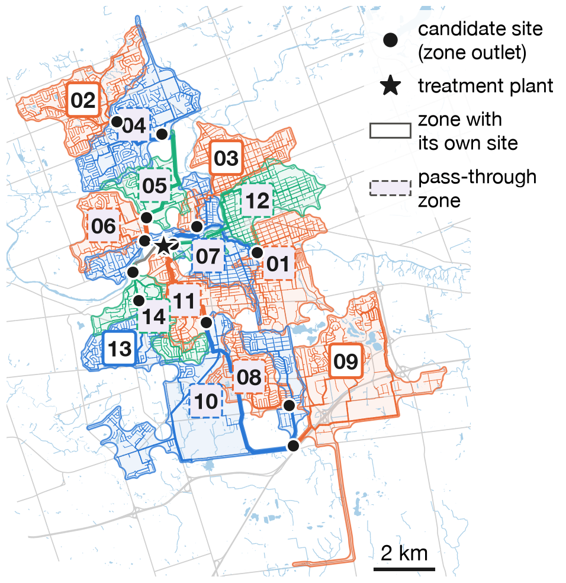{.fig-fill .figctr style="height:420px;width:auto;max-height:420px"}

[Most uniform partition (Lucertini et al. 1993), by dynamic programming; splits follow their largest pipe for zoning only. Appendix 4.]{.src .tight}
:::
::: {.column width="54%"}
[Each zone's outlet is a candidate site: a pumping station or a maintenance hole without a drop.]{.takeaway}

[ of  are **pass-through** zones (dashed): their outlet also carries other zones.]{.takeaway}

{style="width:100%;margin:0.2em 0 0 0"}
:::
:::


::: {.notes}
- Zones are cut to make populations as even as the network allows. The most uniform partition, which makes the largest and the smallest zone as close as possible, is found exactly by dynamic programming (Appendix 4). 
- Only nodes that could be sampled can be cuts (pumping stations or maintenance holes with no drop structure). 
- To draw zones, each of the  flow splits is assigned to the pipe carrying the most flow, so every arriving sewer's network becomes a tree. 
- The transport model keeps the real splits, so flow down the smaller pipe still reaches another zone's outlet: those are the dashed arrows in the tree diagram. 
- The one from zone 10 to zone 08 is different. It is a flat pipe that flows against its drawn direction in the model (data issue D33). 
- The three sewers arriving at the plant and one pumping station are cut where they
arrive. 
- Pass-through zones matter later: they can only be estimated by differencing two sites.
- The tree on the right shows which zone drains into which, with the plant at the bottom and the four streams that reach it. 
- Solid arrows follow the main path. Dashed arrows are part of a zone's flow that a split sends into another zone's outlet. That is why zones 1, 8, and 12 count as pass-through although nothing drains into them on the main path.
:::

## A plant composite counts every neighbourhood in proportion to its population

::: {.columns}
::: {.column width="64%"}
{.fig-fill}
:::
::: {.column width="36%"}
::: {.eq-small}
$$
\bar C_s = \sum_z \underbrace{f_z}_{\substack{\text{zone}\\ \text{factor}}}\,
\underbrace{C_{s,z}(k)}_{\substack{\text{zone } z\text{'s part at site } s\\ \text{decay rate } k}}
$$
:::
$$
W_{s,z} = \frac{f_z C_{s,z}}{\sum_{z'} f_{z'} C_{s,z'}}
$$

[$W_{s,z}$, the **representation fraction**: the share of a composite's virus that comes from zone $z$.]{.takeaway}
:::
:::

[Plant shares within  points of population shares. Decay changes the log composite by – % per unit change in ln k.]{.src .tight}

::: {.notes}
- Four streams reach the plant: three arriving sewers and the force main of the Berkshire Village pumping station. A sample from one of them counts only the zones it drains, each in proportion to its people. 
- Travel times are hours, so decay and the diurnal hydraulics barely matter for 24 h composites; connectivity, population, and flow splits do. 
- A -fold hot spot in one zone raises the plant composite only
– times, less than the noise of one composite.
- The transport is a linear operator from every release to every site, computed once (Appendix 5). 
- The equation defines a "representation fraction" at each sampling point, which gives the share of that sample that comes from each zone, z. 
:::

## Composites are noisy: a log standard deviation of  at the plant and  upstream

::: {.columns}
::: {.column width="68%"}
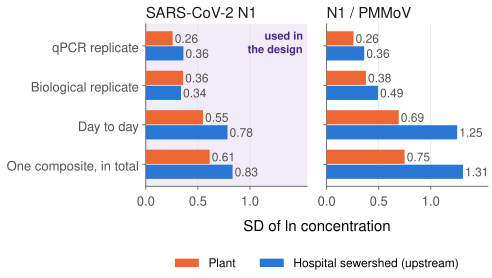{.fig-fill}
:::
::: {.column width="32%"}
::: {.eq-small}
$$
\underbrace{y_c}_{\substack{\text{log result,}\\ \text{composite } c}} =
\underbrace{\ln \bar C_c}_{\text{model}} +
\underbrace{\varepsilon_c}_{\text{noise}}
$$
:::
$$
\varepsilon_c \sim \mathcal{N}(0, \sigma_s^2)
$$

[Upstream, σ = : a single result is often off by a factor of two. Occasional wild values too (Appendix 9).]{.takeaway}

[Noise doesn't change which contrasts a plan identifies, only how many days it takes to tell zones apart. Without it, one day at each of  sites would tell every pair apart.]{.takeaway}
:::
:::

[The group's 24 h composites, Dec 2020 – Aug 2024, after the April 2023 extraction change: plant and the Victoria Hospital sewershed.]{.src .tight}

::: {.notes}
- Error is considered multiplicative (qPCR, concentration steps), so it's normal on the log scale. 
- Split into qPCR replicate, biological replicate, and day-to-day parts about a running trend. The day-to-day part dominates. Later, the analysis replaces the normal with a Student-t, because the residuals have heavier tails than a normal (nu about  at the plant and  upstream).
- This matters because which contrasts a plan can identify depends only on how the flows
mix the zones. Noise scales the information but never changes its rank. How confidently
two zones are told apart is measured in noise widths, so the noise sets the number of days.
- At the precision plan's  site-days every contrast is identified and every pair would be told apart without noise; with this noise about three quarters are, and telling all of them apart takes .
:::

## Only differences between neighbourhoods can be learned, so prevalence never needs a value

::: {.columns}
::: {.column width="58%"}
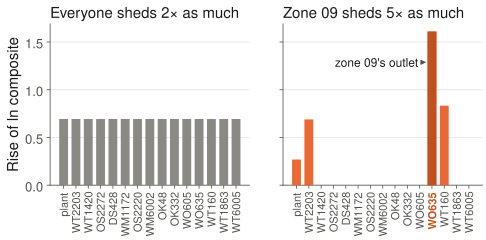{.fig-fill}
:::
::: {.column width="42%"}
::: {.eq-small}
$$
\underbrace{\ln\lambda\,\mathbf{1}}_{\substack{\text{rate per}\\ \text{person}}} +
\underbrace{\ln\mathbf{f}}_{\substack{\text{zone}\\ \text{factors}}} =
\underbrace{\textcolor{#6b6a66}{m\,\mathbf{1}}}_{\text{level}} +
\underbrace{\textcolor{#eb6834}{\mathbf{H}\boldsymbol{\beta}}}_{\text{differences}}
$$
:::

{style="width:92%;margin:0"}

[The level absorbs prevalence and $\lambda$. A plan estimates the  **contrasts** $\boldsymbol\beta$.]{.takeaway}
:::
:::

::: {.notes}
- Anything that multiplies every zone's shedding multiplies every concentration alike (shedding per-person, prevalence and cannot be told apart. Every site concentration rises by the same amount on the log scale (left). 
- A hot zone gives a pattern across sites (right). In the case where Zone
09 is hot, its own outlet, WO635, rises most; the sites downstream of it (WT160, the arriving sewer WT2203, and the plant) rise less, because zone 09 is a smaller share of what they carry, and every other site doesn't move.
- Reading the equation, lambda is the shedding rate per person, common to every zone; f is a vector of all the zones' shedding factors, a multiplier on lambda that is 1 when shedding is uniform. So the left side is each zone's log shedding per person, and the right side splits it into a level shared by all zones and differences between them.
- The picture under the equation is the same idea for the zones' shedding: every zone's log shedding is a shared level (grey, up to the dashed line m) plus a difference (orange: zone 09 up, the rest a little down, so the differences sum to zero).
- The 13 contrasts are the differences. H is a 14 x 13 matrix whose columns are orthonormal and each sum to zero; beta holds 13 numbers. Any such basis gives the same results, so the design needs no shedding or prevalence numbers. 
- The decay rate is the other nuisance parameter, with a prior spanning a factor of  either way.
:::

## Repeat days at the plant add nothing: the plant and its arriving sewers identify at most  of  contrasts [Precision plan (fixed)]{.plan-tag}

::: {.columns}
::: {.column width="62%"}
{.fig-fill style="max-height:420px"}
:::
::: {.column width="38%"}
[$\mathbf{S}$: the information a plan's composites carry about the  contrasts, once the level and decay are allowed for.]{.takeaway}

[**Rank of $\mathbf{S}$**: how many contrasts can be estimated at all. Below , some zones are mixed in the same proportions at every sampled site, and no number of days separates them.]{.takeaway}

$$
\operatorname{Cov}(\hat{\boldsymbol\beta}) \succeq \mathbf{S}^{-1}
$$

[$\hat{\boldsymbol\beta}$: the estimate of $\boldsymbol\beta$. At full rank $\mathbf{S}$ can be inverted, so every estimated contrast has a finite variance.]{.takeaway}
:::
:::

::: {.notes}
- β would be fitted by weighted least squares of the log composites on each site's representation fractions (Appendix 6).
- S is the Schur complement of the Fisher information matrix, which is the information about the contrasts that remains once the level and decay rate are estimated from the same data. It tells us how precise the fit can be, before any sample is taken.
- Repeat days shrink the noise on the same mix but can't unmix it. 
- The plant alone identifies no contrasts; the level absorbs its one direction. Its arriving sewers mix zones in different proportions, but none isolates a zone. One day at  sites identifies all . In general: n arriving streams identify at most n − 1 contrasts.
- The bound Cov(β̂) ≥ S⁻¹ is the Cramér–Rao bound; no unbiased estimate of the contrasts from this plan can have a smaller covariance than S⁻¹, so S⁻¹ is the best precision the plan can ever give, before any sample is taken. The weighted least-squares fit of the linearized model reaches the bound when the errors are normal. 
- The blue curve is the "precision plan", which is the name will used for this plan: it is a greedy search, each step adding the site-day that identifies the most contrasts, then the most overall precision (D_s, the log determinant of S).
:::

## A greedy search tells every pair of zones apart in [ site-days]{.nowrap} at  sites [Separation plan (fixed)]{.plan-tag}

::: {.columns}
::: {.column width="37%"}
::: {.eq-small}
$$
\delta_{ij}^2 = \sum_s \omega_s \Delta_s^2 - \frac{\left(\sum_s \omega_s \Delta_s\right)^2}{\sum_s \omega_s}
$$
:::

[$\Delta_s$: the difference at site $s$ between a -fold hot spot in zone $i$ and one in zone $j$; $\omega_s = n_s/\sigma_s^2$. Told apart if $\delta_{ij} \ge 2$.]{.takeaway}

[**Separation plan:** tell every pair apart, which is stricter than identifying every contrast.]{.takeaway}

[**Greedy search:** start with one day at the plant; each step adds the site-day that tells the most new pairs apart.]{.takeaway}
:::
::: {.column width="63%"}
```{=html}
<div class="gsteps" id="gsteps" aria-label="The greedy plan for telling pairs apart, one site-day at a time: the pairs told apart and the days at each site">
  <div class="gs-head"><span class="gs-count"></span><button class="gs-replay" type="button">↻ replay</button></div>
  <div class="gs-body">
    <div class="gs-tri"><div class="gs-title">Pairs of zones</div><div class="gs-grid"></div>
      <div class="gs-key"><i class="on"></i>told apart (δ ≥ 2) <i class="new"></i>this step <i></i>not yet</div></div>
    <div class="gs-plan"><div class="gs-title">Days at each site (zone outlet)</div><div class="gs-rows"></div></div>
  </div>
</div>
<script src="figures/greedy_frames.js"></script>
<script>
(function () {
  const D = window.GREEDY_FRAMES, root = document.getElementById("gsteps"), n = D.zones.length;
  const S = D.steps, last = S.length - 1, grid = root.querySelector(".gs-grid");
  const count = root.querySelector(".gs-count");
  // Lower triangle: row i (zones 02..14) against column j < i, with zone labels on the diagonal.
  grid.style.gridTemplateColumns = "repeat(" + n + ", 1fr)";
  const cells = [];
  for (let i = 1; i < n; i++) for (let j = 0; j < n; j++) {
    const d = document.createElement("div");
    if (j < i) { d.className = "c"; cells.push(d); }
    else if (j === i) { d.className = "lab"; d.textContent = D.zones[i]; }
    grid.append(d);
  }
  const bottom = document.createElement("div"); bottom.className = "gs-bottom";
  bottom.style.gridTemplateColumns = grid.style.gridTemplateColumns;
  D.zones.slice(0, n - 1).forEach(z => { const d = document.createElement("div"); d.textContent = z; bottom.append(d); });
  grid.after(bottom);
  const cols = ["P"].concat(D.zones), rows = root.querySelector(".gs-rows");
  const rowEls = cols.map(c => {
    const r = document.createElement("div"); r.className = "gs-row";
    r.innerHTML = '<span class="gs-lab">' + (c === "P" ? "plant" : c) + '</span><span class="gs-dots"></span>';
    rows.append(r); return r;
  });
  function show(k) {
    const st = S[k], prev = k ? S[k - 1].told : null;
    count.innerHTML = "<b>" + st.site_days + " site-day" + (st.site_days > 1 ? "s" : "") + "</b> at " + st.sites +
      " site" + (st.sites > 1 ? "s" : "") + ": <b>" + st.pct + " %</b> of pairs told apart";
    cells.forEach((c, i) => {
      const on = st.told[i] === "1";
      c.className = "c" + (on ? (prev && prev[i] === "0" ? " new" : " on") : "");
    });
    rowEls.forEach((r, i) => {
      const n = st.days[cols[i]] || 0, add = cols[i] === st.added && k > 0;
      r.querySelector(".gs-dots").innerHTML = Array.from({ length: n }, (_, j) =>
        '<i' + (add && j === n - 1 ? ' class="new"' : "") + "></i>").join("");
      r.classList.toggle("used", n > 0);
    });
  }
  let timer = null;
  function play() {
    clearInterval(timer); let k = 0; show(0);
    timer = setInterval(() => { k += 1; show(k); if (k >= last) clearInterval(timer); }, 750);
  }
  show(last);
  root.querySelector(".gs-replay").addEventListener("click", play);
  // Automated captures (decktape for the PDF) keep the finished plan; a live deck plays on arrival.
  if (navigator.webdriver) return;
  (function wait() {
    if (!window.Reveal || !Reveal.isReady()) return setTimeout(wait, 100);
    const here = () => Reveal.getCurrentSlide() && Reveal.getCurrentSlide().contains(root);
    Reveal.on("slidechanged", () => { if (here()) setTimeout(play, 400); else { clearInterval(timer); show(last); } });
    if (here()) setTimeout(play, 400);
  })();
})();
</script>
```
:::
:::

[Only the count of days at each site matters: the dry-day flows repeat and the hot spot is taken as steady.]{.takeaway}

::: {.notes}
- Now we look at a different goal from the last slide. In the previous case, a plan was judged by how many contrasts it identifies and how precisely (the precision plan, ranked by rank and then D_s). 
- Full rank means every contrast can be estimated, not that a hot spot stands out from the noise. Here a plan is judged by how many pairs of zones it tells apart above the noise, which is what locating a hot spot needs. This is the "separation plan" while the previous was the "precision plan".
- delta uses normal noise with the composite standard deviations (0.61 at the plant and arriving sewers, 0.83 upstream), no background between zones, and no heavy tails. It is computed from expected results, before any sample. 
- The level is unknown, so only the pattern across sites counts: the weighted mean of
delta is removed. 
- Two noise widths apart still confuses the pair about 16 % of the time, which is why we will find this is still not enough to locate a hot zone. 
- The triangle is every pair of zones; a square fills once the pair is told apart. The greedy search starts from one day at the plant, tries one more day at every candidate site, keeps the day that separates the most pairs, and repeats; it never
revisits earlier choices. 
- The score is the number of pairs told apart, not D_s. 
- After 4 site-days the plant and three sites separate 18 % of pairs, after  site-days  %, and after  site-days every pair.
- Yellow marks what the latest step added. The site-day is on the right (a dot per day at that zone's outlet) and the pairs it told apart on the left. 
- The early days spread over new sites; the late ones are repeat days at the outlets of pass-through zones (05, 06, and 10) for the last stubborn pairs. From 27 site-days on, many steps tell no new pair apart, and only 4 more pairs fall in the last 12
steps. The last step, a fifth day at zone 06's outlet, separates 06 from 07.
- A fixed plan is a count of days at each site. The hydraulics repeat from day to day and the hot spot is assumed steady over the campaign, so each composite at a site carries the same information whichever day it's taken. The days could be consecutive, spread out, or in parallel.
- The adaptive campaign is different: there the order matters, because each day's choice uses the results so far.
:::

## A zone is named when its probability of being hot reaches  % [Adaptive campaign]{.plan-tag}

[Separation scores a plan on its expected results; naming decides from one campaign's noisy results.]{.takeaway}

::: {.columns}
::: {.column width="58%"}
::: {.eq-small}
$$
y_c =
\underbrace{\textcolor{#6b6a66}{\mu}}_{\text{level}} +
\underbrace{\textcolor{#c2501c}{Y_{s,h}}}_{\substack{\text{hot-zone}\\ \text{pattern}}} +
\underbrace{\textcolor{#12805a}{\textstyle\sum_z \hat W_{h,s,z}\, u_z}}_{\text{background}} +
\underbrace{e_c}_{\text{noise}}
$$
:::

::: {.eq-small}
$$
p_h =
\frac{\overbrace{\pi_h}^{\text{prior}}\;\overbrace{p(\mathbf{y}\mid h)}^{\text{fit to the results}}}
{\sum_{h'} \pi_{h'}\, p(\mathbf{y}\mid h')},
\qquad
\underbrace{P_z}_{\substack{\text{zone } z\\ \text{is hot}}} = \sum_{h \text{ names } z} p_h
$$
:::

[**Hypothesis $h$:** one zone is $\kappa$-fold hot; $\hat W_{h,s,z}$ are its fractions.]{.takeaway}

[**Background** $u_z \sim \mathcal{N}(0, \tau^2)$: zones differ even with no outbreak, and $\tau = $ is assumed. Noise: Student-$t$.]{.takeaway}
:::
::: {.column width="42%"}
```{=html}
<div class="pbars" id="pbars" aria-label="Each zone's probability of being hot, day by day, in the example campaign, day by day, with the composites analyzed">
  <div class="pb-head"><span class="pb-morning">Day 23</span><button class="pb-replay" type="button">↻ replay</button></div>
  <div class="pb-plot">
    <div class="pb-y"><span style="bottom:100%">1.0</span><span style="bottom:50%">0.5</span><span style="bottom:0">0.0</span></div>
    <div class="pb-area">
      <div class="pb-grid" style="bottom:50%"></div>
      <div class="pb-stop"><span>95 %: name the zone</span></div>
      <div class="pb-bars pb-row"></div>
    </div>
    <div class="pb-ylabel">P(hot)</div>
  </div>
  <div class="pb-x pb-row"></div>
  <div class="pb-dots"><span class="pb-rowlab">results in</span><div class="pb-row" data-k="results"></div></div>
  <div class="pb-dots"><span class="pb-rowlab">sent to lab</span><div class="pb-row" data-k="sent"></div></div>
  <div class="pb-xlabel">Zone (a dot is a composite at the zone's outlet)</div>
</div>
<script src="figures/posterior_frames.js"></script>
<script>
(function () {
  const D = window.POSTERIOR_FRAMES, root = document.getElementById("pbars");
  const cols = ["P"].concat(D.zones), last = D.mornings.length - 1;
  const label = root.querySelector(".pb-morning");
  root.querySelector(".pb-stop").style.bottom = (100 * D.stop) + "%";
  const cells = row => cols.map(c => { const d = document.createElement("div"); d.className = "pb-col" + (c === "P" ? " plant" : ""); row.append(d); return d; });
  const barCells = cells(root.querySelector(".pb-bars"));
  cells(root.querySelector(".pb-x")).forEach((d, i) => d.textContent = cols[i] === "P" ? "plant" : cols[i]);
  const dotRows = [...root.querySelectorAll(".pb-dots .pb-row")].map(r => ({ k: r.dataset.k, cells: cells(r) }));
  const els = barCells.slice(1).map((c, i) => {
    const b = document.createElement("div"); b.className = "pb-bar" + (D.zones[i] === D.hot ? " hot" : "");
    const v = document.createElement("span"); v.className = "pb-val";
    c.append(v, b); return { b, v };
  });
  function show(k) {
    const p = D.p[k], top = p.indexOf(Math.max(...p));
    label.textContent = "Day " + D.mornings[k] + (p[top] >= D.stop ? ": zone " + D.zones[top] + " named" : "");
    els.forEach((e, i) => {
      e.b.style.height = (100 * p[i]) + "%";
      e.v.style.bottom = (100 * p[i]) + "%";
      e.v.textContent = i === top && p[i] > 1.5 / p.length ? p[i].toFixed(2) : "";
    });
    dotRows.forEach(r => r.cells.forEach((c, i) => {
      const n = D[r.k][k].filter(x => x === cols[i]).length;
      c.innerHTML = '<i class="pb-dot"></i>'.repeat(n);
    }));
  }
  let timer = null;
  function play() {
    clearInterval(timer); let k = 0; show(0);
    timer = setInterval(() => { k += 1; show(k); if (k >= last) clearInterval(timer); }, 700);
  }
  show(last);
  root.querySelector(".pb-replay").addEventListener("click", play);
  // Automated captures (decktape for the PDF) keep the last day; a live deck plays on arrival.
  if (navigator.webdriver) return;
  (function wait() {
    if (!window.Reveal || !Reveal.isReady()) return setTimeout(wait, 100);
    const here = () => Reveal.getCurrentSlide() && Reveal.getCurrentSlide().contains(root);
    Reveal.on("slidechanged", () => { if (here()) setTimeout(play, 400); else { clearInterval(timer); show(last); } });
    if (here()) setTimeout(play, 400);
  })();
})();
</script>
```
:::
:::

[Bars: one simulated adaptive campaign, a -fold hot spot in zone , the plant and 2 held upstream composites analyzed each day, results back  days later.]{.src .tight}

::: {.notes}
- Pair separation is computed before any sample is taken, from the expected results, with normal noise and no background. It says whether two zones would look different
on average. 
-  A campaign has a set of noisy results, so it has to answer a different question: which zone is hot, and how sure are we? That needs a probability for every zone at once, against all 13 rivals, from the results actually in hand, and a rule for when to stop. 
- Separating every pair is necessary for that but not enough, as the next slide shows.
- In a campaign, the analysis doesn't fit all 13 contrasts. Instead, it compares one hypothesis per candidate hot zone, each fitted by iteratively reweighted least squares, and turns the fits into probabilities.
- Hypothesis h: which zone is hot, and how strongly (kappa of ); Y_{s,h} is the pattern it predicts, and W-hat_{h,s,z} are the representation fractions with h's shedding, so the background reaches each site in proportion to the zone's share there. 
- Bayes' rule over hypotheses: each names a hot zone and a factor from a set (strength isn't known). mu and u are integrated out (Laplace), so the evidence depends on the hypothesis and on tau only.
- The background doesn't change from day to day, so repeat days don't average it out: a site that reads high can be explained by a zone that always runs a little high. 
- Student-t lets one wild composite be an outlier rather than a hot spot.
- Comparing the equation to what came before: mu is the level from the contrasts slide (it absorbs the rate per person and the prevalence); Y_{s,h} = ln sum_z W_{s,z} f_{h,z} is the representation fractions slide with hypothesis h's shedding (kappa in the hot zone, one elsewhere); the background u_z is the differences H beta from the contrasts slide, now treated as random with spread tau rather than estimated; e_c is the noise slide's epsilon, with heavier tails.
- The difference Y_{s,h} minus Y_{s,h'} between two hypotheses is the Delta_s in the pair separation: naming compares exactly the patterns the fixed plan was built to tell apart.
- The bars play through every day of the example adaptive campaign coming up: it simulates one 5-fold hot spot in zone 09, the plant and two held upstream composites analyzed each day, results back  days later. Of  such campaigns,  named zone 09; this one has the median site-days (, named on day ).
- The dots under the bars are the composites: filled, the results that arrive that day and update the bars; hollow, the composites the lab starts that day, chosen from those bars. 
- Each upstream site is a zone's outlet, so a dot sits under that zone; the plant has its own column and is analyzed every day. Two dots in one column are two held days from the same site.
- Zone 01 leads early (about 0.3), then 07 for a few days; from day 13 zone 09 leads, climbing with two setbacks as results scatter, and is named on the last day.
:::

## A fixed plan that separates every pair names the hot zone at  % in only  % of runs [Separation plan (fixed)]{.plan-tag}

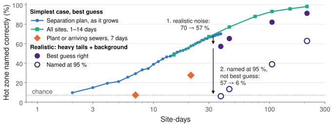{.fig-fill}

[Simplest case: the naming model without the background and heavy tails. The plant alone:  %, chance.]{.takeaway}

::: {.notes}
- Pair separation is a property of the plan; naming is a property of a campaign's results. 
- Separation compares expected results: a gap of  standard deviations between two zones. 
- One campaign is one noisy draw, and at that gap the pair is still confused about  % of the time. With 13 rivals, the small chance that each overtakes the true zone adds up.
- Two analyses are on the plot. The simplest case (blue, green, orange) is the naming model of the previous slide with the background u_z set to zero, normal rather than Student-t noise, and the hot-spot strength known; the best guess is then simply the most likely zone. 
- The realistic case (purple) is that model in full, with simulated data that have heavy tails and a background.
- Let's look at the drop at the fixed plan's  site-days in two steps. 
- Step 1, the noise: with the same score (is the best guess right?) it falls from  % to  %, through wild values and persistent differences between zones that the analysis has to allow for. 
- Step 2, the score: being named at  % asks for
more than being the best guess, since the true zone must beat every rival by a clear margin, which happens in only  % of runs. 
- Even 14 days at every site reach only  %. The plan was designed to separate pairs, not to reach confidence. Therefore one should report the share of simulated campaigns that name the right zone, not pair separation.
:::

## An adaptive campaign follows the results: it starts at the arriving sewers, then turns to the high ones [Adaptive campaign]{.plan-tag}

```{=html}
<div class="cmap" id="cmap" aria-label="The example adaptive campaign on the map, day by day: each zone shaded by its probability of being hot, the composites analyzed, and the probabilities over time">
  <div class="cm-head"><span class="cm-day">Day 23</span><button class="cm-replay" type="button">↻ replay</button></div>
  <div class="cm-body">
    <div class="cm-mapbox">
      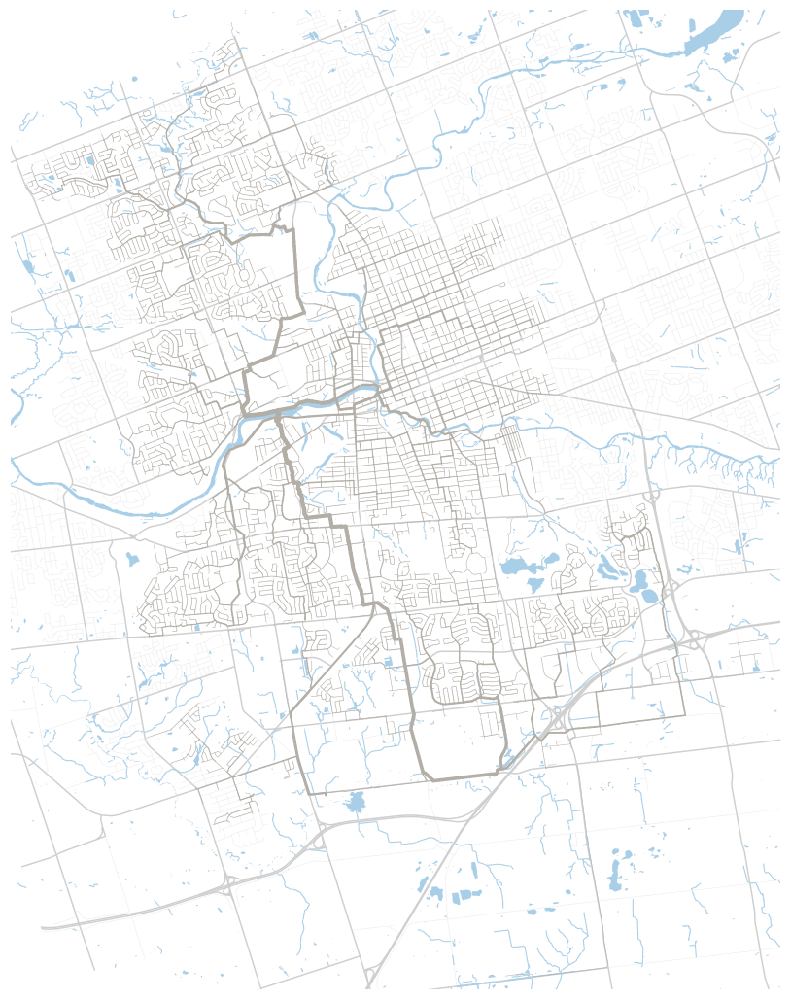
      <svg class="cm-svg" preserveAspectRatio="none"></svg>
    </div>
    <div class="cm-side">
      <svg class="cm-chart" viewBox="0 0 740 300"></svg>
      <div class="cm-key">
        <span class="cm-ramp"></span> zone's probability of being hot, 0 → 1
        <br><i class="dot in"></i> results in that day <i class="dot sent"></i> sent to the lab that day
      </div>
    </div>
  </div>
</div>
<script src="figures/posterior_frames.js"></script>
<script src="figures/campaign_map.js"></script>
<script>
(function () {
  const D = window.POSTERIOR_FRAMES, M = window.CAMPAIGN_MAP, root = document.getElementById("cmap");
  const NS = "http://www.w3.org/2000/svg", mk = (t, a, p) => { const e = document.createElementNS(NS, t);
    for (const k in a) e.setAttribute(k, a[k]); if (p) p.append(e); return e; };
  const last = D.mornings.length - 1, hot = D.hot, label = root.querySelector(".cm-day");
  // --- map: zones shaded by probability, labels, sites
  const svg = root.querySelector(".cm-svg");
  svg.setAttribute("viewBox", M.viewBox.join(" "));
  const zEl = {}, sEl = {};
  D.zones.forEach(z => { zEl[z] = mk("path", { d: M.zones[z].d, class: "cm-zone" }, svg); });
  D.zones.forEach(z => { const t = mk("text", { x: M.zones[z].lx, y: M.zones[z].ly, class: "cm-zl" }, svg); t.textContent = z; });
  Object.entries(M.sites).forEach(([k, [x, y]]) => {
    const g = mk("g", {}, svg);
    if (k === "P") mk("path", { d: `M${x},${y - 420}L${x + 120},${y - 130}L${x + 420},${y - 130}L${x + 180},${y + 60}L${x + 270},${y + 360}L${x},${y + 180}L${x - 270},${y + 360}L${x - 180},${y + 60}L${x - 420},${y - 130}L${x - 120},${y - 130}Z`, class: "cm-plant" }, g);
    const ring = mk("circle", { cx: x, cy: y, r: 330, class: "cm-sent" }, g);
    const dot = mk("circle", { cx: x, cy: y, r: k === "P" ? 0 : 150, class: "cm-site" }, g);
    sEl[k] = { ring, dot };
  });
  // --- chart: every zone's probability over the days, revealed up to the current day
  const ch = root.querySelector(".cm-chart"), L = 52, R = 720, T = 16, B = 250;
  const d0 = D.mornings[0], d1 = D.mornings[last] + 1;  // one day past the last, so its step has width
  const X = d => L + (R - L) * (d - d0) / (d1 - d0), Y = p => B - (B - T) * p;
  [0, 0.5, 1].forEach(v => { mk("line", { x1: L, x2: R, y1: Y(v), y2: Y(v), class: "cm-grid" }, ch);
    mk("text", { x: L - 8, y: Y(v) + 5, class: "cm-tick", "text-anchor": "end" }, ch).textContent = v.toFixed(1); });
  [1, 5, 10, 15, 20].filter(d => d <= D.mornings[last]).forEach(d =>
    mk("text", { x: X(d), y: B + 20, class: "cm-tick", "text-anchor": "middle" }, ch).textContent = d);
  mk("text", { x: (L + R) / 2, y: B + 44, class: "cm-axis", "text-anchor": "middle" }, ch).textContent = "Day of campaign";
  mk("text", { x: 12, y: (T + B) / 2, class: "cm-axis", "text-anchor": "middle", transform: `rotate(-90 12 ${(T + B) / 2})` }, ch).textContent = "P(hot)";
  mk("line", { x1: L, x2: R, y1: Y(D.stop), y2: Y(D.stop), class: "cm-stop" }, ch);
  mk("text", { x: L + 6, y: Y(D.stop) - 6, class: "cm-tick" }, ch).textContent = "95 %: name the zone";
  const clip = mk("clipPath", { id: "cm-clip" }, mk("defs", {}, ch));
  const clipR = mk("rect", { x: 0, y: 0, width: X(D.mornings[0]), height: 300 }, clip);
  const lines = mk("g", { "clip-path": "url(#cm-clip)" }, ch);
  // steps: each day's probability holds until the next day's update, as in the paper's figure
  const steps = i => D.mornings.map((d, k) => `${X(d)},${Y(D.p[k][i])} ${X(d + 1)},${Y(D.p[k][i])}`).join(" ");
  D.zones.forEach((z, i) => { if (z === hot) return; mk("polyline", { points: steps(i), class: "cm-other" }, lines); });
  const hi = D.zones.indexOf(hot);
  mk("polyline", { points: steps(hi), class: "cm-hot" }, lines);
  const now = mk("line", { y1: T, y2: B, class: "cm-now" }, ch);
  const hotLab = mk("text", { class: "cm-hotlab", "text-anchor": "end" }, ch); hotLab.textContent = "zone " + hot + " (hot)";
  function show(k) {
    const p = D.p[k], top = p.indexOf(Math.max(...p)), d = D.mornings[k];
    label.textContent = "Day " + d + (p[top] >= D.stop ? ": zone " + D.zones[top] + " named" : "");
    D.zones.forEach((z, i) => { zEl[z].style.fillOpacity = (0.06 + 0.8 * p[i]).toFixed(3);
      zEl[z].classList.toggle("named", p[i] >= D.stop); });
    Object.entries(sEl).forEach(([c, e]) => {
      e.ring.classList.toggle("on", D.sent[k].includes(c));
      e.dot.classList.toggle("in", D.results[k].includes(c)); });
    clipR.setAttribute("width", X(d + 1) + 1);
    now.setAttribute("x1", X(d + 1)); now.setAttribute("x2", X(d + 1));
    hotLab.setAttribute("x", X(d + 1) - 6); hotLab.setAttribute("y", Y(p[hi]) - 8);
  }
  let timer = null;
  function play() {
    clearInterval(timer); let k = 0; show(0);
    timer = setInterval(() => { k += 1; show(k); if (k >= last) clearInterval(timer); }, 750);
  }
  show(last);
  root.querySelector(".cm-replay").addEventListener("click", play);
  // Automated captures (decktape for the PDF) keep the last day; a live deck plays on arrival.
  if (navigator.webdriver) return;
  (function wait() {
    if (!window.Reveal || !Reveal.isReady()) return setTimeout(wait, 100);
    const here = () => Reveal.getCurrentSlide() && Reveal.getCurrentSlide().contains(root);
    Reveal.on("slidechanged", () => { if (here()) setTimeout(play, 400); else { clearInterval(timer); show(last); } });
    if (here()) setTimeout(play, 400);
  })();
})();
</script>
```

[Each day the lab analyzes the plant and 2 held composites; results arrive  days later. Named on day  after  site-days.]{.takeaway}

::: {.notes}
- In the adaptive campaign, each day, sites are chosen to separate the hypotheses still in contention, weighted by their current probabilities. 
- This example campaign is the one with site-days closest to the median of those that named zone 9. 
- The map plays the campaign day by day. Each zone is shaded by its probability of being hot; filled dots are the composites whose results arrive that day, rings the
composites the lab starts that day. The chart on the right draws each zone's probability as the days go by, zone 09 in orange. Zone 01 leads early, then 07; from day 13 zone 09 leads, with two setbacks, and is named on day . 
- The probability of the hot zone falls back twice as results scatter: the analysis allows for outliers and for zones that run high without a hot spot.
:::

## Adaptive campaigns name the hot zone in  % of runs, and  % of names are right [Adaptive campaign vs separation plan]{.plan-tag}

{.fig-fill}

[Median  site-days over  days. With no hot spot, a zone is named in  % of runs.]{.takeaway}

::: {.notes}
- The fixed plans of the previous slide are faded in the background; the stars are adaptive campaigns, scored the same way (named at  %, realistic noise and background).
- Each star on a curve is a different number of upstream composites a day, from 1 upward, always with the plant; more per day moves a campaign right, in site-days.
- Black: each day's results are back before the next day's sites are chosen. This is the best case.
- Purple: the realistic lab. Every sampler collects each day and the composites are held; the lab analyzes the plant and the 2 it chooses, and their results are back  days later. Holding lets the campaign go back to a day already collected rather than wait for a new one.
- The labelled point is the base case used in the rest of the talk: the hot zone is named in  % of runs, over a median of  site-days and  days.
- Compare the separation plan:  % at  site-days; 14 days at every site reaches only  %, with several times the site-days.
-  % of names are right. The rest of the campaigns end without a name rather than with a wrong one.
- With no hot spot at all, a zone is named in only  % of runs.
- The analysis has to carry the features of the data. The same campaigns analyzed with normal errors, no background, and a known strength name a zone in nearly every run, but only  % of the names are right, and with no hot spot they still name one in  % of runs.
- The lab's -day turnaround costs time and samples more than accuracy: the black and purple curves reach nearly the same share.
- More composites a day shorten the campaign: from  days with 1 a day to  with 4. Beyond about four they add site-days and little else.
:::

## Only a strong outbreak is found, and only if neighbourhood differences aren't underestimated [Adaptive campaign]{.plan-tag}

::: {.columns}
::: {.column width="50%"}
[How strong the hot spot is]{.panel-head .ctr}

{.fig-fill style="max-height:330px"}

[Named at 95 %:  % at [2-fold]{.nowrap},  % at [3-fold]{.nowrap},  % at [10-fold]{.nowrap}.]{.takeaway}
:::
::: {.column width="50%"}
[How much zones differ with no outbreak]{.panel-head .ctr}

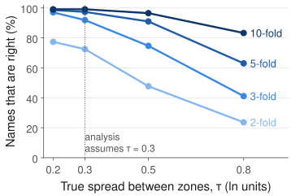{.fig-fill style="max-height:330px"}

[If τ =  but  is assumed, right names fall from  % to &nbsp;% ([5-fold]{.nowrap}), with no warning.]{.takeaway}
:::
:::

::: {.notes}
- Left: how strong the hot spot has to be. kappa is the hot zone's shedding per person relative to the other zones; the talk so far used -fold.
- Purple stars: the held adaptive campaign. Squares: every site, 7 days each. Circles: the separation plan. Solid lines: zones differ by the assumed amount (tau = ); dashed: zones differ more than assumed (tau = ), with the analysis unchanged.
- The adaptive campaign names the hot zone in  % of runs at 2-fold,  % at 3-fold, and  % at 10-fold. It reaches  % at about -fold, or -fold if zones differ more.
- A weak hot spot mostly ends with no name, not a wrong one: at 2-fold,  % of campaigns end without a name and  % with a wrong one.
- The fixed plans do worse at every strength: at 10-fold,  % for 7 days at every site and  % for the separation plan.
- What is realistic (Appendix 7): case rates in the worst parts of Toronto and Louisville were about 1.5–3.5 times the city's, typical of a worse-off neighbourhood; N1/PMMoV in sewersheds of 10–20 thousand people differed 5–9-fold, closer to an early local outbreak.
- So with the plant and two upstream composites a day for up to  days, this is a tool for a strong, early local outbreak, not for routine differences between neighbourhoods.
- Right: tau, the spread of ordinary differences between zones with no outbreak, is the one assumed input to the analysis. The x axis is the true tau in the simulation, the dotted line the assumed value, and each line a hot-spot strength.
- A smaller tau than assumed does no harm. A larger one turns "no answer" into a confident wrong answer: at 5-fold, right names fall from  % to  % at tau =  and  % at .
- A weak hot spot is more exposed: at 2-fold, right names fall from  % to  %, while campaigns without a name drop from  % to  %. Nothing in the campaign warns of this.
- Assuming a larger tau isn't a fix. An analysis that assumes  keeps  % of names right at a true , but when the truth is  it names the right zone in  % of runs instead of  %, and runs its full  days. Only at 10-fold is the cost small ( against  %).
- The fix is to measure tau: a few weeks of composites at the candidate sites in ordinary times would bound the background plus flow-model error.
- Flow-model error, simulated as a bias at each upstream site, matters less: at 5-fold, , , and  % of names stay right for a bias of 0.1, 0.2, and 0.3 (Appendix 10).
:::

## Precision follows a zone's place in the network, not its marginalization [Precision plan (fixed)]{.plan-tag}

[A plan estimates some zones worse than others. Are those the more marginalized neighbourhoods? **ON-Marg** scores Ontario neighbourhoods on four dimensions.]{.takeaway}

{.fig-fill style="max-height:390px"}

[Precision plan at  site-days. Pass-through zones (blue) are least precise on every dimension.]{.takeaway}

::: {.notes}
- Next we turn to equity of the sampling plans. Finding an outbreak is one use of upstream data; the other is routine monitoring, where every neighbourhood should be watched about equally well.
- Boston (slide 3) showed that how sites are compared can delay alerts in more vulnerable neighbourhoods. Here the question is whether the network itself does that.
- Back to the precision plan, which estimates every zone, at the first point where it identifies every contrast: one day at  sites.
- Each dot is a zone; the y axis is the standard deviation of its log shedding factor. Higher is worse.
- The  zones with their own site sit at about . The  pass-through zones, estimated as the difference of two noisy composites, range from  to .
- ON-Marg scores each dissemination area (DA) on four dimensions. Material resources covers low income, unemployment, lone-parent families, education, and housing in need of repair. A zone's score is the population-weighted mean of its DAs.
- Spearman's rho with each: material resources  (p = ), households and dwellings  (p = ), age and labour force  (p = ), racialized and newcomer  (p = ). With 14 zones none is clear; households and dwellings is the largest, worth naming if asked.
- The pass-through zones are somewhat more marginalized on average, but the uncertainty doesn't gather among the more marginalized residents. Nothing in a network guarantees that, so the check belongs in any design.
:::

## Designing for the worst-estimated zone brings every zone within a factor of  in  site-days, not  [Precision plan vs fair plan]{.plan-tag}

::: {.columns}
::: {.column width="53%"}
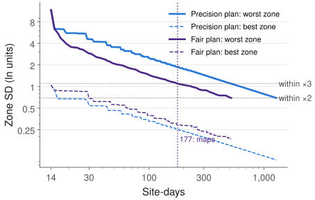{.fig-fill style="max-height:400px"}
:::
::: {.column width="47%"}
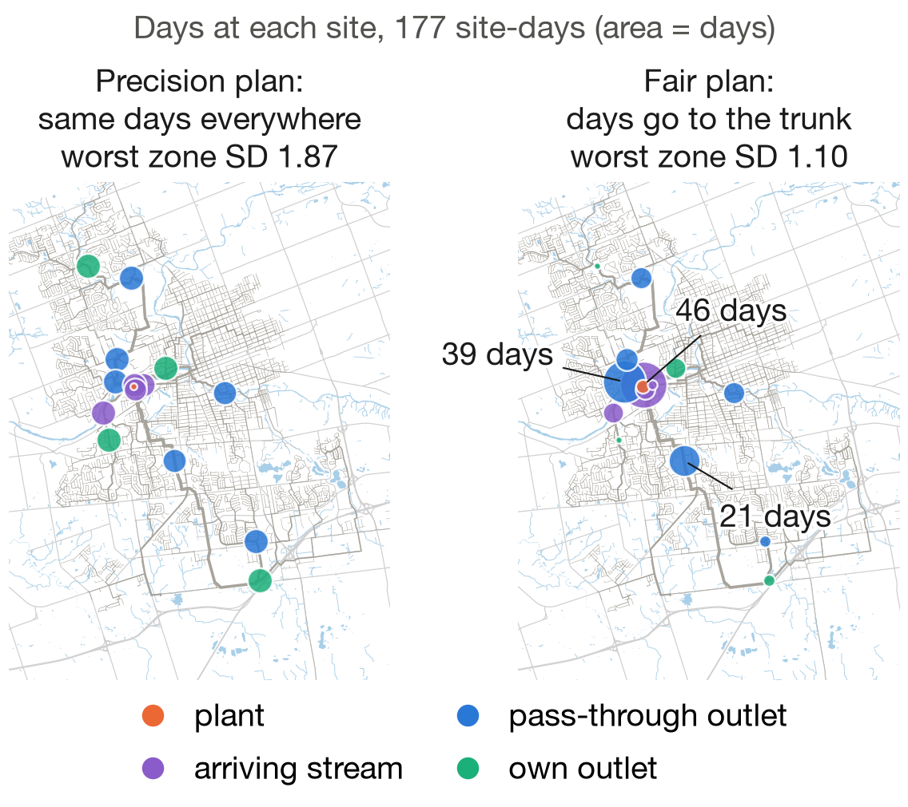{.fig-fill .figctr style="height:410px;width:auto;max-height:410px"}
:::
:::

[The **fair plan** adds each site-day where it most helps the worst-estimated zone; the best-estimated zones pay for it.]{.takeaway}

::: {.notes}
- Left: the worst-estimated zone (solid) and the best (dashed) as site-days are added, for the precision plan (blue) and the fair plan (purple). The dotted lines are every zone within a factor of 2 or 3; a factor of  is a standard deviation of  on the log scale.
- The precision plan maximizes overall precision (D_s), so added days go mostly to zones already well estimated. From  site-days on, its worst zone stays – times less precise than its best.
- The fair plan (minimax) adds each site-day where it most reduces the largest zone standard deviation. From  site-days on, the ratio is –.
- Every zone within a factor of :  site-days against . Within a factor of :  against .
- The cost: the best-estimated zones are less precise, a standard deviation of  against  at 45 site-days.
- Right: where each plan puts its  site-days; marker area by days, colour by the kind of site (legend under the maps). The precision plan spreads them nearly evenly. The fair plan puts most at three trunk sites, the arriving sewer WT1420 and the outlets of zones 06 and 10, which separate the pass-through zones from what flows into them. No new sites are needed.
- Both plans use only the 15 main candidate sites. A zoning cut by marginalization or a wider pool of sites doesn't remove the pass-through disadvantage (Appendix 12).
:::

## Conclusions

- A plant composite counts every neighbourhood by its population, so no number of days at the plant can locate a rise.
- Telling every pair of zones apart on paper isn't enough: the plan built to do it names the hot zone in only  % of campaigns.
- With a network model, adaptive sampling with held composites names a strong outbreak in  % of campaigns, a 2–3-fold one rarely.
- Names can be trusted only if the analysis allows for wild values and ordinary differences between neighbourhoods, which should be measured.
- Zones between sites on a trunk sewer are estimated worst; designing for the worst zone fixes most of it.

::: {.notes}
- Where each claim was shown: the plant, slides 9 and 12; separation not enough, slide 15; adaptive campaigns, slides 16–18; trusting the names, slide 18; equity, slides 19–20.
- What a program needs for this: the network topology, the population upstream of each candidate site, and its own lab's noise, which a utility and a lab already hold.
- Limits: dry weather only; shedding by residents only; the background between zones is assumed rather than measured.
- The next step is to measure that background: a few weeks of composites at the candidate sites in ordinary times.
:::

## Questions?

::: {.columns}
::: {.column width="60%"}
Christopher T. DeGroot · christopher.degroot@uwo.ca

Co-author: Anthony P. R. Sherratt

[Funding: NSERC (RGPIN-2024-05703) and the Ontario Ministry of the Environment, Conservation and Parks. Thanks to the City of London for plant access, sampling, and help with the GIS data.]{.takeaway}
:::
::: {.column width="40%"}
{.fig-fill .figctr style="height:300px;width:auto"}

::: {style="text-align:center"}
[Slides: degrootresearchgroup.github.io/presentation-2026-birs]{.src}
:::
:::
:::

::: {.notes}
- The QR code opens these slides, with the backup slides and these notes. The next slide is a jump list of the appendices for questions.
:::

## Backup slides, by appendix {#appendix-index}

```{=html}
<div class="app-index">
<a href="#/app-1"><b>A1</b>Literature</a>
<a href="#/app-2"><b>A2</b>Data</a>
<a href="#/app-3"><b>A3</b>Hydraulic model</a>
<a href="#/app-4"><b>A4</b>Zoning</a>
<a href="#/app-5"><b>A5</b>Transport</a>
<a href="#/app-6"><b>A6</b>Information</a>
<a href="#/app-7"><b>A7</b>Hot-spot strength</a>
<a href="#/app-8"><b>A8</b>Posterior and site choice</a>
<a href="#/app-9"><b>A9</b>Noise</a>
<a href="#/app-10"><b>A10</b>Robustness and campaign settings</a>
<a href="#/app-11"><b>A11</b>Laboratory limits</a>
<a href="#/app-12"><b>A12</b>Equity alternatives</a>
<a href="#/app-13"><b>A13</b>Cross-site checks and reproducibility</a>
</div>
```

::: {.notes}
- Jump list for questions: click an appendix to go to its divider; each divider links back here.
:::

## Appendix 1: Literature {#app-1 .divider}

[Prior work on choosing sites or locating sources in sewer and water networks.]{.divider-sub}

[↩ All appendices](#appendix-index){.back-link}

## Each prior study has one or two of the features a plan for locating shedding needs

| Study | Objective | Noise | Transport | Shedding everywhere | Repeat days | Identifiability | Adaptive | Even precision |
|---|---|:-:|:-:|:-:|:-:|:-:|:-:|:-:|
| Calle 2021 | Coverage; binary search | – | – | ◐ | – | – | ● | ◐ |
| Kim 2022 | Equal monitored areas | – | – | – | – | – | ◐ | ◐ |
| Larson 2020 | Binary search | – | – | ◐ | – | – | ● | – |
| Nourinejad 2021 | Sensors for binary search | – | – | ◐ | – | – | ● | ◐ |
| Gkatzioura 2023 | Detection | – | ● | – | – | – | – | – |
| Banik 2017 | Detection; entropy | – | ● | – | – | – | – | – |
| Banik 2015 | Joint entropy | – | ● | – | – | – | – | – |
| Yao 2024 | Entropy of detects | – | ◐ | – | – | – | – | – |
| Yao 2025 | Entropy; Bayesian elimination | ◐ | ◐ | – | – | – | ● | – |
| Salem 2024 | Inverse-model accuracy | – | ● | ◐ | – | – | – | – |
| Crowley 2025 | Mutual information | ● | ◐ | – | – | – | – | – |
| Yang 2024 | Bayesian inversion | ● | ● | ◐ | – | ◐ | ◐ | – |
| Wagner 2015 | Adjoint inversion | ● | ● | – | – | – | – | – |
| Xie 2015 | D-optimal decay | ◐ | ● | – | – | ● | – | – |
| Khorshidi 2018 | Value of information | – | ● | ◐ | – | – | – | – |
| Torres 2026 | Disaggregating plant data | ● | – | ● | – | – | – | – |
| Impalli 2025 | Cost, frequency | ◐ | – | – | ● | – | – | – |
| **This study** | Fisher information; naming | ● | ● | ● | ● | ● | ● | ● |

: {.lit-table .lit-full}

[● part of the study; ◐ in part; – absent. Shaded: the five needs counted on slide 3. Paper Table 1; SI explains each rating.]{.src .tight}

::: {.notes}
- The paper's Table 1; the SI explains each rating. No prior study has more than two of the five shaded needs fully; this study has all five.
:::

## Appendix 2: Data {#app-2 .divider}

[Data sources and the register of data issues.]{.divider-sub}

[↩ All appendices](#appendix-index){.back-link}

## Three of the  data issues would each have cut off or blocked part of the catchment

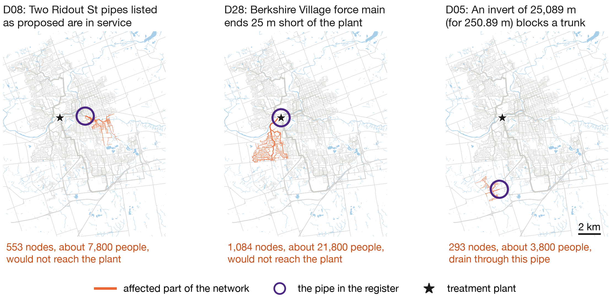{.fig-fill style="max-height:430px"}

[Final model network. D08 and D28: the part that reaches the plant only through the pipe. D05: the part that drains through it. Each fix confirmed by the City.]{.src .tight}

::: {.notes}
- D08: two 900 mm pipes listed as proposed are in service (City). Dropping proposed pipes would lose the orange area, including the Victoria Hospital sewershed, our one upstream sampler.
- D28: the Berkshire Village force main ends 25 m short of the plant's low-level station. The City confirms it discharges to the headworks, so a 25 m link is added; without it the south-west is missing.
- D05: an invert recorded as 25,089.0 m, almost certainly 250.89 m, blocks the trunk. Out-of-range inverts are filled; the City confirmed this one. This is the "typo in an invert" of slide 6.
:::

## Most issues are settled by the data or the City;  rest on assumptions the open data can't confirm

::: {.columns}
::: {.column width="58%"}
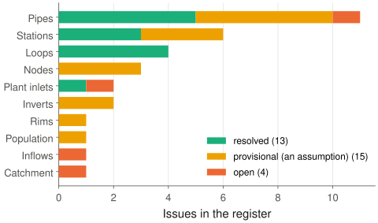{.fig-fill style="max-height:400px"}
:::
::: {.column width="42%"}
[**Resolved:** settled by the data, by the method, or by the City's answers to our questions.]{.takeaway}

[**Provisional:** an assumption where the data are ambiguous or incomplete, e.g. ideal pumps (no capacities in the data) or interpolated inverts.]{.takeaway}

[**Open:** can't be resolved from the data; the element is omitted or kept as recorded, e.g. a flat pipe whose direction the data don't show (D33).]{.takeaway}
:::
:::

[Data: City of London sewer network, 2021 census dissemination blocks and areas, zoning, NRCan HRDEM lidar, plant flow summaries, ECCC rainfall, the group's monitoring composites, ON-Marg 2021. Register: paper SI Table S-dataissues.]{.src .tight}

::: {.notes}
- The open issues: inflows from stations outside the data (D20), pipes leaving the catchment at summits (D31), the direction of the flat pipe at OS1424 (D33), and the share of flow at the south inlet (D34).
- D33 matters most for the design: it sends part of one zone's sewage into another arriving sewer (Appendix 5).
:::

## Appendix 3: Hydraulic model {#app-3 .divider}

[Network build, loading, and calibration.]{.divider-sub}

[↩ All appendices](#appendix-index){.back-link}

## The Greenway plant serves  people through a branching network of sewers

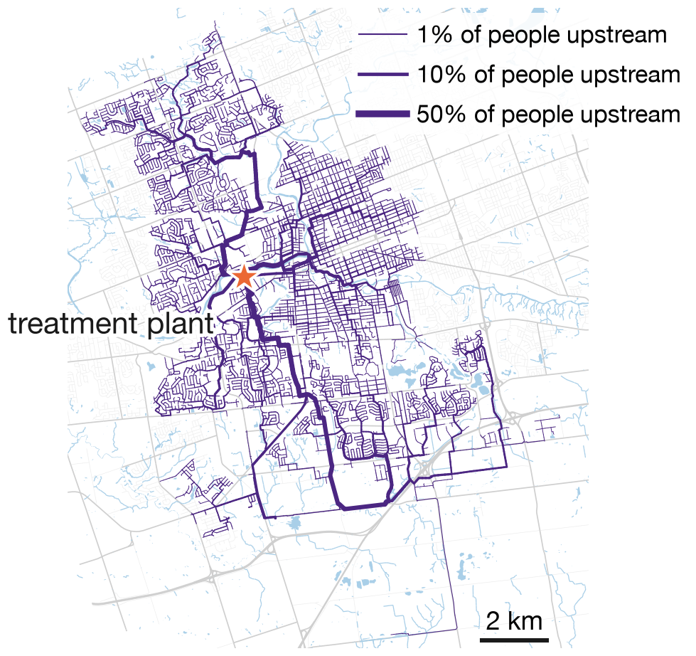{.fig-fill .figctr style="height:440px;width:auto;max-height:440px"}

[Greenway Wastewater Treatment Plant, London, Ontario: about 60 % of the city's wastewater. Pipe width shows the people upstream.]{.src .tight}

::: {.notes}
- The whole catchment behind slide 2: every public sewer, width by the share of the people upstream.
:::

## Every build step is a rule applied to the whole network, with each fill and change logged

| Step | Rule | In the Greenway catchment |
|---|---|---|
| Selection | Built sanitary pipes; overflow pipes dropped |  "proposed" pipes taken as built,  removed |
| Rims | Checked against 1 m lidar ground; missing or implausible ones set to ground plus the median offset | Offset  m (IQR ) over  nodes;  filled,  replaced |
| Reused IDs | Pipe ends with one ID far apart become separate nodes |  IDs split, up to  m apart |
| Gaps | Inverts interpolated by length; sizes copied from downstream |  of  missing values filled |
| Population | Census blocks shared among pipes within  m by drain connections |  blocks (median  people);  people at  nodes |
| Stations | Ideal pumps; force mains full, Hazen–Williams |  stations,  force-main pipes |
| Routing | Dynamic wave, Manning $n$ = , three repeating dry days, day 3 kept | Flooding  %, continuity error  % |

: {.app-table}

::: {.notes}
- swmmbuilder reads a city's layers through a schema, so the same code serves other cities.
- The rules follow the City's design manual where it has one: Manning n, force-main roughness, and the 0.6 m drop rule for sampling sites.
- Ideal pumps are reasonable in dry weather: stations pass the peak hourly flow with the largest pump out, and wet wells fill in 30 minutes or more, short against a 24 h composite.
:::

## Infiltration and non-residential flow are calibrated to the plant's dry-day mean and night minimum

::: {.columns}
::: {.column width="52%"}
$$
\underbrace{Q_{\mathrm I} + Q_{\mathrm R} + Q_{\mathrm N}}_{\text{model mean}} = \bar Q_{\text{plant}}
$$
$$
\underbrace{Q_{\mathrm I} + a\,(Q_{\mathrm R} + Q_{\mathrm N})}_{\text{model minimum}} = r_{\min}\, \bar Q_{\text{plant}}
$$

[$Q_{\mathrm R}$ is fixed by the population at  L per person per day. $a$, the share of wastewater still arriving at the night minimum, comes from the model run, so the two are iterated.]{.takeaway}

[Dry day: under  mm of rain on each of  days and no snow on the ground. Reference flow ×10³ m³/d over  dry sampling days.]{.takeaway}
:::
::: {.column width="48%"}
```{=html}
<div class="stat-stack">
  <div class="stat"><b></b> L/s residential, from the census</div>
  <div class="stat"><b></b> L/s groundwater infiltration ( % of the flow)</div>
  <div class="stat"><b></b> L/s non-residential, carrying no virus</div>
  <div class="stat"><b></b> = <i>a</i>, converged after  run</div>
</div>
```

[The City's design allowance would give  L/s, more than the plant's lowest dry-day flow in most months, so it is only a bound.]{.takeaway}
:::
:::

[Minimum night-flow method (US EPA 2014), with the wastewater still in transit taken from the model. Paper SI, calibration.]{.src .tight}

::: {.notes}
- The plant's dry-weather flow is seasonal, higher February to April and lower in late summer, so a steady infiltration at the all-season median sits between the seasons.
- An infiltration share of  % is within reported ranges (20–55 % near Atlanta, up to about 70 % with high groundwater).
- Non-residential flow dilutes but carries no biomarker.
:::

## The model reproduces the plant's diurnal swing on dry days

::: {.columns}
::: {.column width="62%"}
{.fig-fill}
:::
::: {.column width="38%"}
[Model mean on day 3: ×10³ m³/d,  % of the plant's dry-weather flow.]{.takeaway}

[Maximum / mean: model , plant  (IQR –).]{.takeaway}

[Minimum / mean: model , plant  (IQR –), matched by construction.]{.takeaway}

[The household peak of × the mean arrives about an hour later at about half that height.]{.takeaway}
:::
:::

[Plant:  dry days of the City's summaries,  – .]{.src .tight}

::: {.notes}
- The model's peak is a little higher than the plant's: the household pattern is a smart-meter profile from England (Abu-Bakar et al. 2021), used for its shape only.
- A 24 h composite integrates the day, so it depends on the daily totals, not the exact shape. Day 3 repeats day 2: daily means differ by  %.
:::

## Appendix 4: Zoning {#app-4 .divider}

[How the catchment is cut into zones.]{.divider-sub}

[↩ All appendices](#appendix-index){.back-link}

## Zones are cut so the largest and smallest are as close in population as the network allows {.smaller}

::: {.columns}
::: {.column width="48%"}
Choose cut nodes $c_1, \dots, c_{N}$ to

$$
\min_{\text{cuts}} \; \Big(\max_z P_z - \min_z P_z\Big)
$$

then, among the equally good cuts,

$$
\min \sum_z \big(s_z - 1/N\big)^2
$$

[$P_z$, $s_z$: zone $z$'s people and share; $N = $ zones. The most uniform partition of Lucertini et al. (1993).]{.takeaway}
:::
::: {.column width="4%"}
:::
::: {.column width="48%"}
1. **A tree.** At each of the  flow splits, keep the pipe with the largest flow.
2. **Eligible cuts.** Pumping stations, and maintenance holes without a drop (no sewer arriving 0.6 m or more above the outlet).
3. **Dynamic program.** From the upstream ends down, tabulate (cuts above, people flowing on) with every closed zone in $[L, U]$; search $L$ for the least $U - L$. Exact, up to rounding.
4. **Real flows kept.** Transport sends flow down every branch, so zones can share flow.
:::
:::

[Paper SI, zoning. The roots (the arriving sewers and one pumping station) are always cut.]{.src .tight}

::: {.notes}
- The dynamic program keeps, at each node, the pairs (cuts above, people still flowing on) that leave every closed zone between L and U, and searches L for the least U − L. Ties are broken by the squared share deviations.
- Largest-flow assignment is only for drawing zones; the representation fractions use the real flow splits.
:::

## Appendix 5: Transport {#app-5 .divider}

[The operator from every release to every site.]{.divider-sub}

[↩ All appendices](#appendix-index){.back-link}

## Advection, decay, and mixing are linear in the mass released, so one operator serves every scenario

::: {.columns}
::: {.column width="52%"}
::: {.eq-small}
$$
C_s(t) = \frac{1}{Q_s(t)} \sum_n \int G_{s,n}(t, t'; k)\, R_n(t')\, \mathrm{d}t'
$$
:::

[$G_{s,n}$: the fraction of a parcel released at node $n$ at time $t'$ that reaches site $s$ at $t$, times $e^{-k\,t_{\mathrm{tr}}}$ for its travel time. $Q_s$: the flow at the site.]{.takeaway}

$$
\frac{\partial C}{\partial t} + v\,\frac{\partial C}{\partial x} = -kC \quad\text{in each link}
$$

[Complete mixing at nodes; no dispersion. $v = Q/A$ from SWMM at every link and time.]{.takeaway}
:::
::: {.column width="48%"}
::: {.app-steps}
1. **Release** a parcel from every node every  s over days 2 and 3, carrying $R_n(t')\,\Delta t$.
2. **March** it through each link at the link's current velocity.
3. **Split** it among a node's outlets in proportion to their flows.
4. **Bin** its mass at each site between the two nearest output times.
:::

[Checked against the analytic single-pipe solution; mass is conserved to $10^{-12}$ without decay. Longest travel time  h; the day-3 composite misses  % of the shed mass.]{.takeaway}
:::
:::

[Paper SI, transport operator. For an instantaneous sample, a row of $G$ is the adjoint state of Wagner et al. (2015); here it is built forwards, once for all sites.]{.src .tight}

::: {.notes}
- Splitting parcels keeps the operator linear, so a composite for any shedding pattern is a weighted sum of the zone parts C_{s,z}(k): one transport run, then every plan is linear algebra.
- Links are oriented by their mean flow and links with no flow removed, which opens the two loops in the data.
- Decay acts only over travel times of hours, so the composite changes only – % per unit change in ln k (slide 9).
:::

## Population shares on the network would give nearly the same design, except where a pipe runs backwards

::: {.columns}
::: {.column width="56%"}
| | Population shares on the graph | Transport model |
|---|:-:|:-:|
| Site-days to separate every pair |  |  |
| Hot zone named right, 7 days at every site |  % |  % |

: {.app-table}

[Graph shares have no travel time, timing within the day, or decay; the transport model adds them, and they change little.]{.takeaway}
:::
::: {.column width="44%"}
[**The one exception:** zone  gives  % of the composite at  in the transport model, and none on the graph.]{.takeaway}

[A flat pipe between two maintenance holes at the same invert (register D33) flows against its drawn direction in the model, carrying part of the zone's sewage into that trunk.]{.takeaway}

[Decay barely moves the plant's shares: within  points of population up to  d⁻¹.]{.takeaway}
:::
:::

[Paper SI, transport operator and robustness.]{.src .tight}

::: {.notes}
- Compared at every candidate site: the transport model's representation fraction against the zone's share of the people upstream on the network graph.
- Close everywhere except the D33 pipe, whose direction should be asked of the City.
- At an extreme loss rate of  per day, far zones fall to  and near zones rise to  times their share; the separation plan then needs fewer site-days (Appendix 10).
:::

## Appendix 6: Information {#app-6 .divider}

[Fisher information, the Schur complement, and the greedy search.]{.divider-sub}

[↩ All appendices](#appendix-index){.back-link}

## Every composite at a site adds the same row of sensitivities, weighted by its noise

Linearized log composites; $\hat{\boldsymbol\beta}$ is their weighted least-squares fit:

$$
y_c \approx m + \mathbf{w}_s\mathbf{H}\boldsymbol{\beta} + \frac{\partial\ln\bar C_s}{\partial\ln k}\,\ln k + \varepsilon_c
$$

$$
\mathbf{j}_s = \left[\, \mathbf{w}_s\mathbf{H},\; 1,\; \partial\ln\bar C/\partial\ln k \,\right]
\qquad
\mathbf{F} = \sum_s \frac{n_s}{\sigma_s^2}\, \mathbf{j}_s^\top \mathbf{j}_s + \mathbf{F}_{\mathrm{prior}}
$$

$$
\mathbf{S} = \mathbf{F}_{\beta\beta} - \mathbf{F}_{\beta n}\mathbf{F}_{nn}^{-1}\mathbf{F}_{n\beta},
\qquad
\operatorname{Cov}(\hat{\boldsymbol\beta}) \succeq \mathbf{S}^{-1},
\qquad
D_s = \ln\det\mathbf{S}
$$

[Subscript $n$: the nuisances $m$ and $\ln k$. Zone SD: $\sqrt{[\mathbf{H}\mathbf{S}^{-1}\mathbf{H}^\top]_{zz}}$.]{.takeaway}

::: {.notes}
- The rank of S depends on which sites are sampled, not on how often or how noisily.
- The subtracted term is the information spent telling the contrasts from the level and decay.
- The response to the level is 1 because the representation fractions sum to one; the response to ln k comes from automatic differentiation through the transport operator.
- F_prior is 1/(ln 3)² at ln k: a prior spanning a factor of three either way.
:::

## The Schur complement is exactly the contrasts' block of the inverse information

::: {.columns}
::: {.column width="55%"}
::: {.eq-small}
$$
\mathbf{F} = \begin{pmatrix} \mathbf{F}_{\beta\beta} & \mathbf{F}_{\beta n} \\ \mathbf{F}_{n\beta} & \mathbf{F}_{nn} \end{pmatrix},
\qquad
\mathbf{F}^{-1} = \begin{pmatrix} \mathbf{X} & \mathbf{Y} \\ \mathbf{Y}^\top & \mathbf{Z} \end{pmatrix}
$$

Bottom block row of $\mathbf{F}\mathbf{F}^{-1} = \mathbf{I}$:

$$
\mathbf{F}_{n\beta}\mathbf{X} + \mathbf{F}_{nn}\mathbf{Y}^\top = \mathbf{0}
\;\Rightarrow\;
\mathbf{Y}^\top = -\mathbf{F}_{nn}^{-1}\mathbf{F}_{n\beta}\mathbf{X}
$$

Top block row:

$$
\left(\mathbf{F}_{\beta\beta} - \mathbf{F}_{\beta n}\mathbf{F}_{nn}^{-1}\mathbf{F}_{n\beta}\right)\mathbf{X} = \mathbf{I}
\;\Rightarrow\;
\mathbf{X} = \mathbf{S}^{-1}
$$
:::
:::
::: {.column width="45%"}
[The bound for the contrasts is $\mathbf{S}^{-1}$, not $\mathbf{F}_{\beta\beta}^{-1}$: estimating the level and decay costs information.]{.takeaway}

[$\mathbf{F}_{nn}$ is always invertible: every composite informs the level, and the prior informs the decay rate.]{.takeaway}

[With one contrast and one nuisance, $S = a - b^2/c$. It is $a$ when $b = 0$, and zero (not identified) when $b^2 = ac$, i.e. the two parameters move the composites the same way.]{.takeaway}

[For the linearized model with normal errors, weighted least squares reaches the bound.]{.takeaway}
:::
:::

::: {.notes}
- Why S⁻¹, not F_ββ⁻¹, is the bound for the contrasts: inverting F by blocks, the contrasts' block of F⁻¹ is S⁻¹.
- F_ββ⁻¹ would apply only if the level and decay rate were known.
:::

## Both greedy searches add one site-day at a time, ranking candidates lexicographically

$$
\mathbf{n}^{(t+1)} = \mathbf{n}^{(t)} + \mathbf{e}_{s_t},
\qquad
s_t = \operatorname*{arg\,lexmax}_s\; \mathbf{g}\!\left(\mathbf{n}^{(t)} + \mathbf{e}_s\right),
\qquad \mathbf{n}^{(0)} = \mathbf{e}_{\text{plant}}
$$

::: {.columns}
::: {.column width="50%"}
**Precision plan** (slide 12)

::: {.eq-small}
$$
\mathbf{g}_P = \Big( \operatorname{rank}\mathbf{S},\; D_s,\; \ln\det(\mathbf{F} + \varepsilon\mathbf{I}) \Big)
$$
:::

[$\varepsilon = $ keeps the last term finite while $\mathbf{F}$ is singular; it decides the steps before full rank, when $D_s = -\infty$ for every candidate.]{.takeaway}
:::
::: {.column width="50%"}
**Separation plan** (slide 13)

::: {.eq-small}
$$
\mathbf{g}_H = \Big( \#\{\delta_{ij} \ge 2\},\; \sum_{i \ne j} \min(\delta_{ij}/2,\, 1),\; \min_{i \ne j} \delta_{ij} \Big)
$$
:::

[Stops when every pair is separated, or after  steps.]{.takeaway}
:::
:::

[Check against the exact optimum of the relaxed problem (fractional site-days, convex for the fair plan's minimax): from 45 site-days the greedy fair plan is within – % of the best possible worst zone.]{.takeaway}

::: {.notes}
- Lexicographic: take the largest first component, break ties on the second, then the third.
- Greedy never revisits a choice, so it can be beaten; the relaxed problem bounds by how much. At 14 site-days the gap is large ( against ), because the relaxed optimum spreads fractions of a day that whole days can't copy.
:::

## Telling every pair apart takes  site-days; one day at every site tells  % apart

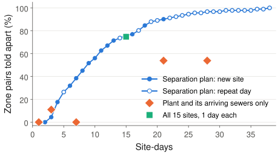{.fig-fill style="max-height:430px"}

[-fold hot spot.  site-days at  sites separate  % of pairs.]{.src .tight}

::: {.notes}
- The pair-separation curve behind slide 13, against the plant and its arriving sewers alone and one day at every site.
:::

## With normal noise, the separation plan's wrong guesses fall on the next zone along the same branch

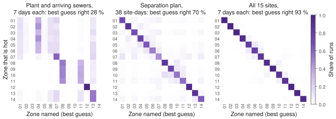{.fig-fill style="max-height:420px"}

[Simplest case: normal noise, no background, hot-spot strength known;  runs per zone. Rows sum to one.]{.src .tight}

::: {.notes}
- Rows: the zone made hot. Columns: the zone the best guess names. The diagonal is a right guess.
- The misses are mostly neighbours on the same branch of the drainage tree (slide 8), whose composites differ only at the site between them.
- The separation plan is right  % of the time; seven days at every site,  %. With realistic noise both fall (slide 15).
:::

## Appendix 7: Hot-spot strength {#app-7 .divider}

[Why κ = , and what weaker hot spots look like.]{.divider-sub}

[↩ All appendices](#appendix-index){.back-link}

## A 2–3-fold excess is typical of a worse-off neighbourhood; 5–10-fold of an early local outbreak

- Case rates in the most affected parts of Toronto and of Louisville sewersheds: about 1.5–3.5 times the city or county, over weeks to months.
- N1/PMMoV in sewersheds of 10,000–20,000 people in one city: 5–9-fold apart.
- Much larger ratios only at sites of a few hundred people.
- The design uses κ = ; results are given for κ from 2 to 10 (slide 18).

[Direct evidence on one neighbourhood of 10,000–25,000 people against the rest of a city is thin.]{.takeaway}

[Rao et al. 2021 (Toronto), Yeager et al. 2021 (Louisville), Baldwin et al. 2023 (N1/PMMoV), Haak et al. 2022 (small sites). Paper SI, hot-spot strength.]{.src .tight}

::: {.notes}
- kappa is the hot zone's shedding per person relative to the other zones; the ratios are read from the cited figures and tables.
- At kappa = 2 the held campaign mostly ends with no name ( % of runs) rather than a wrong one.
:::

## Appendix 8: Posterior and site choice {#app-8 .divider}

[The evidence for each hypothesis, a worked example, and the site-choice score.]{.divider-sub}

[↩ All appendices](#appendix-index){.back-link}

## Each day's sites separate the hypotheses still in contention

$$
U(s) = \sum_{h,h'} p_h\, p_{h'} \left[1 - \exp\!\left(-\frac{\delta_{hh'}(s)^2}{8}\right)\right]
$$

$$
\omega_s(n_s) = \frac{n_s}{\sigma_s^2 + n_s\, \tau^2 \sum_z W_{s,z}^2},
\qquad
\delta_{hh'}^2 = \sum_s \omega_s \Delta_{s,hh'}^2 - \frac{\left(\sum_s \omega_s \Delta_{s,hh'}\right)^2}{\sum_s \omega_s}
$$

[The exponential is the Bhattacharyya overlap of two normals $\delta$ apart. The background enters each site's variance, so repeat days don't average it out.]{.takeaway}

[The sum runs over pairs naming different hot zones; weighting by $p_h p_{h'}$ serves the probable pairs not yet separated.]{.takeaway}

::: {.notes}
- delta_hh'(s) counts every composite chosen or in progress, plus one more at site s.
- Sites are chosen one at a time, so the second site of a day sees the first.
- With tau = 0, omega_s reduces to the n_s/sigma_s² of the fixed-plan separation (slide 13).
:::

## A hypothesis's evidence is its misfit plus a curvature term, by Laplace's approximation

::: {.columns}
::: {.column width="58%"}
::: {.eq-small}
$$
r_c = y_c - Y_{s,h} - \mathbf{x}_{h,c}^{\mathsf T}\boldsymbol\theta,
\qquad
\boldsymbol\theta = (\mu, \mathbf{u})
$$

$$
L_h(\boldsymbol\theta) = \sum_c \frac{\nu_s+1}{2} \ln\!\left(1 + \frac{r_c^2}{\nu_s \gamma_s^2}\right) + \frac{1}{2\tau^2}\sum_z u_z^2
$$

$$
\ln p(\mathbf{y}\mid h) \approx -L_h(\hat{\boldsymbol\theta}_h) - \tfrac12 \ln\det \mathbf{A}_h + \text{const}
$$

$$
\mathbf{A}_h = \sum_c \frac{\nu_s+1}{(\nu_s+3)\gamma_s^2}\, \mathbf{x}_{h,c}\mathbf{x}_{h,c}^{\mathsf T} + \mathbf{P}
$$
:::
:::
::: {.column width="42%"}
[**Hypotheses:**  zones × κ in : , equally likely a priori.]{.takeaway}

[**Scale:** $\gamma_s = \sigma_s\,\Phi^{-1}(0.75)/t_{\nu_s}^{-1}(0.75)$, the same median absolute deviation as the normal error.]{.takeaway}

[**Mode:** iteratively reweighted least squares, weights $(\nu_s+1)/(\nu_s\gamma_s^2 + r_c^2)$,  steps. A wild composite gets a small weight.]{.takeaway}

[**Curvature:** the expected Student-$t$ information, so $\mathbf{A}_h$ stays positive definite however far a composite lies. $\mathbf{P} = \operatorname{diag}(\epsilon, \tau^{-2}, \dots)$.]{.takeaway}
:::
:::

::: {.notes}
- Averaging over mu and u, rather than plugging in their best values, penalizes a hypothesis that fits only if some zone happens to run high.
- A large residual adds to L only through a logarithm, so one wild composite can't decide between hypotheses on its own.
- Simplest case (normal errors, no background, kappa known): A_h is the same for every h and cancels, and the best guess is the maximum-likelihood hypothesis.
:::

## In the example campaign, one low composite rules out zone  on day ; by day  zone  fits best

::: {.columns}
::: {.column width="50%"}
[Day ,  composites]{.panel-head}

[, whose flow is  from zone , reads  below the plant on the log scale. A hot spot there would have raised it.]{.takeaway}

[Best misfit naming zone : , against about  for most others. $P_z$ for zone  falls from  % to  %; the rest share the remainder almost equally.]{.takeaway}
:::
::: {.column width="50%"}
[Day ,  composites]{.panel-head}

[Zone  with κ =  has misfit ; every other zone's best is at least .]{.takeaway}

[A misfit larger by $\Delta L$ multiplies the odds by $e^{-\Delta L}$, so $P_z$ for zone  reaches  %: named.]{.takeaway}

[The curvature term differs between zones by at most : the misfit decides.]{.takeaway}
:::
:::

[The held campaign of slides 14 and 16, rerun with the same seed and its log posterior split into terms. Paper SI, worked example.]{.src .tight}

::: {.notes}
- Values are relative to the plant composite, since the level is unknown.
- By day , zone  beats its best rival by about five units of misfit: odds of roughly e⁵ to one.
:::

## The example campaign returns to zone 09's outlet and its arriving sewer once their results come back high

{.fig-fill}

[Left: each zone's probability by day. Right: the composites analyzed each lab day; orange sites receive zone 09's flow.]{.src .tight}

::: {.notes}
- The static version of slide 16. Results are known  days after the lab starts a composite, so the right panel runs two days ahead of the left.
:::

## Appendix 9: Noise {#app-9 .divider}

[Variance components of a composite, and the tails of its errors.]{.divider-sub}

[↩ All appendices](#appendix-index){.back-link}

## The day-to-day part dominates the noise at both sites, so an upstream composite is noisier

::: {.columns}
::: {.column width="50%"}
$$
y_{dbq} = \mu(t_d) + e_d + e_{db} + e_{dbq}
$$

$$
\sigma = \Big(\sigma_d^2 + \tfrac{1}{2}\big(\sigma_b^2 + \tfrac{1}{3}\sigma_q^2\big)\Big)^{1/2}
$$

[Day $d$, replicate $b$, qPCR well $q$; the trend $\mu$ is the median of the  neighbouring dates, the date itself left out. Robust method of moments.]{.takeaway}
:::
::: {.column width="50%"}
| N1, final extraction protocol | Plant | Hospital |
|---|:-:|:-:|
| Day to day, $\sigma_d$ |  |  |
| Replicate, $\sigma_b$ |  | |
| qPCR, $\sigma_q$ |  | |
| **Reported value, $\sigma$** | **** | **** |
| Classical estimate |  |  |
| Divided by PMMoV |  |  |
| Check, 4-day differences |  |  |

: {.app-table}
:::
:::

[Across monitored plants the log noise falls with population with slope , far from the −0.5 of independent shedders: a size-free part dominates.]{.src .tight}

::: {.notes}
- Final extraction protocol only:  sampling dates at the plant.
- The classical estimates are larger because the errors are heavy-tailed; with them, the separation plan needs  site-days and the median adaptive campaign .
- PMMoV normalization raises the noise at both sites, so it isn't used; in dry weather dilution changes little.
- The hospital stands in for every upstream site. Its lag check is lower than its trend estimate, so the upstream noise may be somewhat high.
:::

## The daily errors have heavier tails than a normal

{.fig-fill}

[Fitted Student-$t$: $\nu$ =  at the plant (90 %: –),  at the hospital (–). Beyond × the typical spread at the plant: data  %, Student-$t$  %, normal  %.]{.takeaway}

::: {.notes}
- A direct fit makes the tails look lighter (short series, and each residual carries its trend's error), so nu is corrected by simulation (raw fits  and ), with a bootstrap for the range.
- The campaigns use nu =  at the plant and its arriving sewers and  upstream.
:::

## Appendix 10: Robustness and campaign settings {#app-10 .divider}

[What changes the effort, and how the campaigns respond to their settings.]{.divider-sub}

[↩ All appendices](#appendix-index){.back-link}

## The separation plan's  site-days are most sensitive to a persistent bias at each site

::: {.columns}
::: {.column width="52%"}
| Assumption | Site-days to separate every pair |
|---|:-:|
| Main analysis |  |
| Site bias $b$ =  | , ,  |
| Decay  →  d⁻¹ |  →  |
| Population shares on the graph |  |
| Classical (not robust) noise |  |

: {.app-table}

[A bias the same every day sets a floor no number of days removes: at $b = 0.2$ the least certain zone stays at  ln units.]{.takeaway}
:::
::: {.column width="48%"}
[**Population error** (blocks vs. areas): – % right against  % without it; no effect detected.]{.takeaway}

[**Drifting truth** (level random walk, zones AR(1)):  % right takes  days at  sites a day,  at .]{.takeaway}

[**Finer zones**, sites decoupled,  site-days: named , , , , and  % of the time for , , , , and  zones.]{.takeaway}

[**A hot spot in part of a zone** (2,000–5,000 people): the right zone only  % of the time at  site-days.]{.takeaway}
:::
:::

[Paper SI, robustness of the hot-spot design.]{.src .tight}

::: {.notes}
- The site bias stands for flow-model error: one offset per site, the same every day. Its effect on the adaptive campaigns' names is small up to 0.2 (slide 18).
- Faster decay helps a fixed plan by sharpening near against far zones, but adds no contrasts.
- Including the plant in each day's panel doesn't shorten the drifting campaigns ( and  days without it).
:::

## The effort depends strongly on the noise of an upstream composite

{.fig-fill style="max-height:330px"}

[Upstream σ from  to : the separation plan needs  to  site-days and the median adaptive campaign  to  (results the same day, not the held campaign of the talk). Dotted: the measured value.]{.takeaway}

::: {.notes}
- Upstream noise is the input the effort depends on most, and it comes from one hospital sewershed (Appendix 9).
:::

## More composites a day shorten a campaign

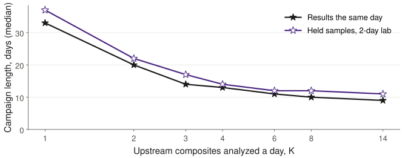{.fig-fill}

[Held composites: one upstream analysis a day names the hot zone in  % of runs over  days; four in  % over .]{.takeaway}

::: {.notes}
- Beyond about four a day, extra analyses add site-days and little else: – % named, up to  site-days with all  upstream sites each day.
:::

## Allowing for a second hot zone keeps first names right, but a zone is rarely confirmed as the only one

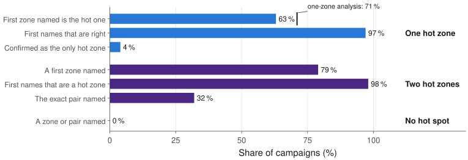{.fig-fill style="max-height:400px"}

[The talk's one-zone analysis, given two hot zones, names one in  % of runs and stops, with no sign of the second.]{.takeaway}

[Every pair of zones added as hypotheses ( in all), with one and two hot zones each  % a priori. Paper SI, two hot zones.]{.src .tight}

::: {.notes}
- A pass-through zone is seen only as the difference of two sites that each mix several zones, so ruling out a second, weaker hot zone takes far more composites than naming the first.
:::

## Appendix 11: Laboratory limits {#app-11 .divider}

[Censored composites near the sample limits of detection (sLOD) and quantification (sLOQ).]{.divider-sub}

[↩ All appendices](#appendix-index){.back-link}

## The lab's limits cost little at Greenway's concentrations, which stay well above the sLOD

::: {.columns}
::: {.column width="64%"}
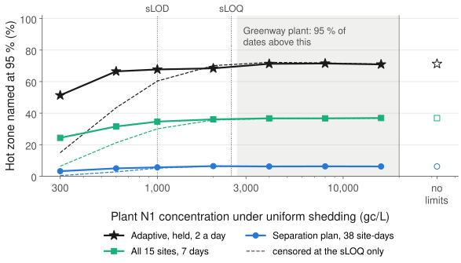{.fig-fill style="max-height:420px"}
:::
::: {.column width="36%"}
[Adaptive campaign above the sLOD: – % against  % with no limits;  % at  gc/L. The plant was quantified on  % of  dates with the final extraction protocol.]{.takeaway}

[Dashed: every composite below the sLOQ treated alike, without the sLOD.]{.takeaway}
:::
:::

[Sample limits of detection (sLOD)  and quantification (sLOQ)  gene copies per litre (1 and 2.5 per qPCR reaction). Censored composites enter through the Student-$t$ probability of their interval.]{.src .tight}

::: {.notes}
- Near the limits the absolute concentration matters, so it is anchored on the plant's N1 under uniform shedding. The candidate sites run  to  times the plant, so they reach the limits at about the same point.
- Below the sLOQ a composite is known only to lie in [sLOD, sLOQ) or below the sLOD. Using the sLOD matters: treating everything below the sLOQ alike drops the adaptive share at the sLOD to  % (dashed).
- Prevalence is an illustration only, since shedding rates are uncertain by a factor of : a plant concentration at the sLOD is about  % prevalence at the clinical rate.
:::

## Appendix 12: Equity alternatives {#app-12 .divider}

[A zoning by marginalization, and a wider pool of candidate sites.]{.divider-sub}

[↩ All appendices](#appendix-index){.back-link}

## Zoning by marginalization lifts the score's between-zone share only from  to 

::: {.columns}
::: {.column width="44%"}
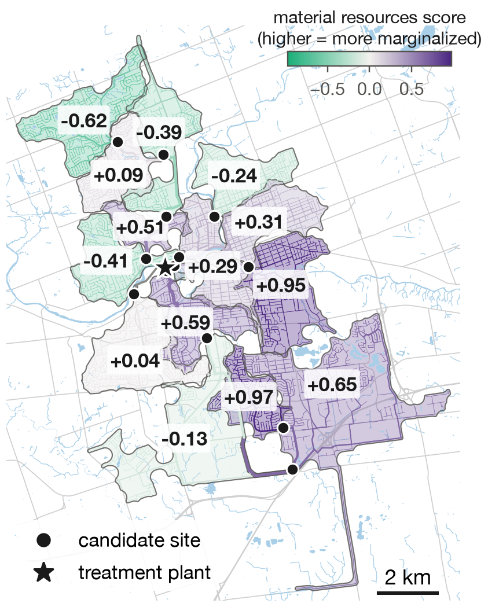{.fig-fill .figctr style="height:440px;width:auto;max-height:440px"}
:::
::: {.column width="56%"}
[Marginalized and other neighbourhoods drain to the same branches. Within a zone, the median spread of material resources scores is ; between zones, .]{.takeaway}

[Even zones down to 2 % of the catchment reach only : about two-thirds of the variation lies within any zoning the network allows.]{.takeaway}

[The most marginalized zone gets its own site, but the zones between trunk sites are still worst, × the best.]{.takeaway}

[Every zone within a factor of :  site-days (main zoning ). Every pair separated:  (main ).]{.takeaway}
:::
:::

[p-regions problem (Duque et al. 2011) solved exactly as a mixed-integer program; zones of – % of the people. Paper SI, alternative zoning.]{.src .tight}

::: {.notes}
- Same eligible nodes and drainage trees as the main zoning, with cuts chosen to make each zone as uniform as possible in material resources.
- R² is the share of the score's variance among all residents that lies between zones.
- Student areas ( DAs, about  people) are kept: at most  % of a zone, and they don't score above the other DAs.
:::

## A wider pool of sites helps, but some zones still have no site that sees most of their people

::: {.columns}
::: {.column width="52%"}
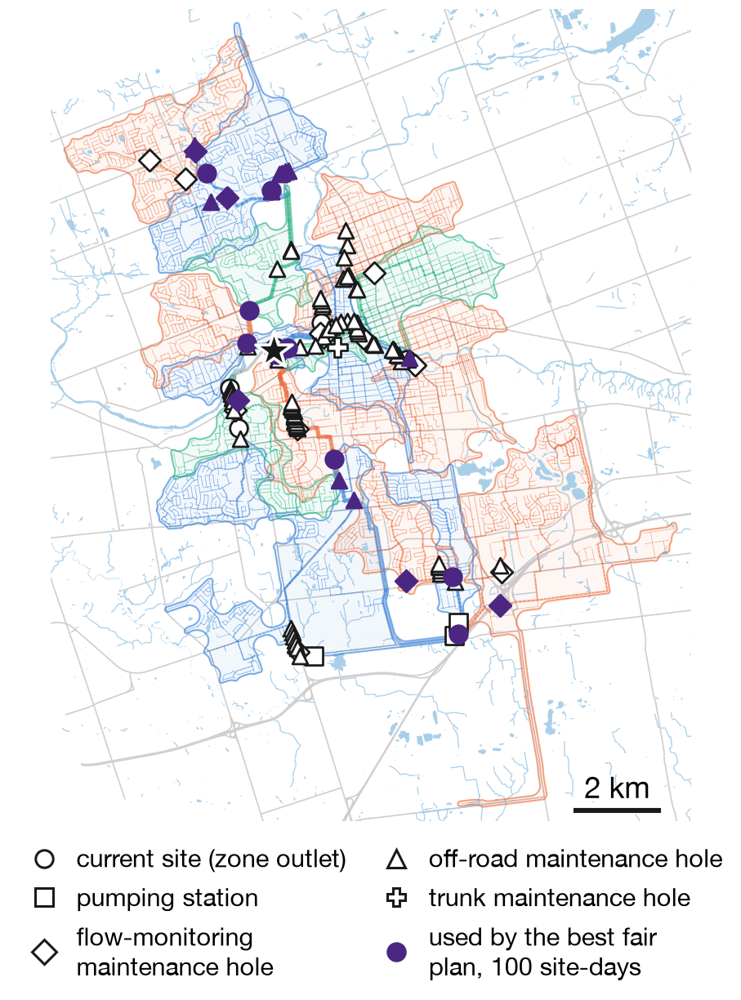{.fig-fill .figctr style="height:440px;width:auto;max-height:440px"}
:::
::: {.column width="48%"}
[ candidates inside the main zones: pumping stations, flow-monitoring and off-road maintenance holes without drops;  dropped below  people.]{.takeaway}

[Every pair separated in  site-days at  sites ( new), against . Every zone within a factor of  in , against .]{.takeaway}

[Zones  have no candidate that sees  % of the zone: their people enter along the trunk sewer itself.]{.takeaway}

[The best fair plan of  site-days still spends  % of its days at .]{.takeaway}
:::
:::

[Filled: sites where the best fractional fair plan spends at least half a day. Paper SI, candidate sites.]{.src .tight}

::: {.notes}
- A site's population is judged by its share of the plant's modelled flow, not the graph count.
- A site that sees only part of a zone is taken to measure the whole zone, which flatters the pool; the population floor limits this.
- The adaptive campaigns were not rerun on this pool.
:::

## Appendix 13: Cross-site checks and reproducibility {#app-13 .divider}

[What the paired plant and hospital composites say, and how to rebuild everything.]{.divider-sub}

[↩ All appendices](#appendix-index){.back-link}

## A hospital surge barely moves the plant, and lab error shared between sites is small for N1

::: {.columns}
::: {.column width="50%"}
[Hospital and plant]{.panel-head}

[On  paired dates the hospital's N1 is a median × the plant's.]{.takeaway}

[For an assumed hospital flow of 250–1,000 m³/d, its share of the plant's N1 load is – %. A 95th-percentile excursion, × its trend, moves the plant – %.]{.takeaway}

[The regression slope of plant on hospital residuals,  (–), is far larger than that share: it measures shared variation such as the lab batch, not hospital sewage.]{.takeaway}
:::
::: {.column width="50%"}
| Same-batch correlation with Greenway | PMMoV | N1 |
|---|:-:|:-:|
| Another London plant |  |  |
| Victoria Hospital sewershed |  |  |

: {.app-table}

[Final extraction protocol. For the N1 design, a batch correlation of about 0.2 is a reasonable upper value.]{.takeaway}
:::
:::

[PMMoV carries no epidemic signal, so a shared PMMoV residual points to the lab or the weather. Paper SI, cross-site checks.]{.src .tight}

::: {.notes}
- The hospital flow hasn't been measured; 250–1,000 m³/d is an assumption.
- Plant and hospital PMMoV are correlated on same-batch dates (n = , interval –), but on one pair of sites, and not between the two plants. The design takes composite errors as independent.
:::

## Every number and figure here is drawn from the paper's result files

- Paper repository: analysis scripts, network model, pinned environment (link at release).
- This deck: `scripts/sync_from_paper.py` copies the result files; `scripts/talk_figures.py` draws every figure from them.
- Numbers on the slides are the paper's own generated values.
- `swmmbuilder`, the open-source package that builds the SWMM model from a city's GIS layers (DeGroot Research Group).

::: {.notes}
- The paper and its repository hold the derivations, the data-issue register, and the scripts behind every number on these slides.
:::
